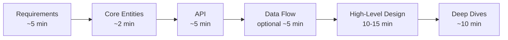

# Delivery Framework

The most common way to fail a system design interview is not delivering a *working* end-to-end system. This framework keeps you linear, visible and on time.

## 1. Requirements (~5 min)

**Functional** are "Users should be able to ..." statements. Negotiate with the interviewer like a PM and pin down the **top 3**. A long list hurts you.

**Non-functional** are quantified system qualities. Pick the 3-5 that matter for *this* system.

| Dimension | Question to ask | Example |
|---|---|---|
| CAP | Consistency or availability on partition? | Feed: available. Payments: consistent |
| Environment | Mobile, low bandwidth, battery? | Video on 3G |
| Scalability | DAU, read/write ratio, bursts, events? | 100M DAU, 100:1 reads |
| Latency | Which operation must be fast? | Redirect under 100 ms |
| Durability | Can we lose data? | Files: never. Likes: tolerable |
| Security | AuthN/Z, data protection? | Private file sharing |
| Fault tolerance | Failure domains, recovery? | Survive an AZ loss |
| Compliance | GDPR, PCI, residency? | Delete within 30 days |

Add **observability** to the list. Interviewers like to hear how you would know it works.

**Estimation**: do math only when it changes the design (single node vs shard, memory vs disk). Say so explicitly and compute it in the flow of the design.

## 2. Core Entities (~2 min)

A bullet list of nouns: actors and resources your API exchanges and your system stores. Keep it a first draft; fields come later when you reach the database.

## 3. API (~5 min)

- Default to **REST** with plural resource nouns. Use gRPC for internal hot paths, GraphQL for diverse clients.
- Derive the user from the **auth token**, never from the body or path.
- Add WebSocket or SSE only for real-time needs, after the core API.
- One endpoint per functional requirement is usually enough.

## 4. Data Flow (optional, ~5 min)

For pipeline systems (crawler, transcoding) list the steps in order. Skip it for CRUD-style products.

## 5. High-Level Design (10-15 min)

- Walk the API endpoint by endpoint and draw the simplest boxes that satisfy it.
- Narrate what state changes on each request.
- Write only the *relevant* columns next to the datastore.
- Note complexity (cache, queue) verbally and **defer** it to deep dives.

## 6. Deep Dives (~10 min)

Harden the design against each NFR, edge cases and bottlenecks. At Staff level you **lead** this phase:

1. Pick the 2-3 problems that actually threaten the NFRs.
2. For each: state the problem, 2 options, the trade-off, your choice, and the failure mode.
3. Close with operations: metrics, alerts, rollout, data growth, and how the design evolves at 10x.

## Staff-level checklist

- [ ] Every NFR has a number and a mechanism that meets it
- [ ] Every data store has an owner, a partition key and a consistency story
- [ ] Every async hop has idempotency and a dead-letter path
- [ ] Single points of failure and blast radius are named
- [ ] Hot keys, thundering herds and retry storms are addressed
- [ ] Observability: SLIs, SLOs, key dashboards, alerts
- [ ] Cost drivers are named (egress, storage tier, cache memory)

## If the interviewer derails you

Say: "Let me complete the high-level design so we have the full picture, then I'm happy to go deep on this." If they insist, follow them. Their signal matters more than your outline; return to the outline afterwards.

## Time check

| Minute | You should be at |
|---|---|
| 7 | Entities done |
| 12 | API done |
| 25 | HLD complete |
| 35+ | Deep dives and wrap-up |

## Agentic add-on

For LLM, RAG and agent systems keep the same six steps and add the items below. Practice them in the [Agentic Problem Breakdowns](../05-agentic-problem-breakdowns/).

| Step | Add this |
|---|---|
| Requirements | **Answer quality** (groundedness, task success rate), **cost per task** (tokens, tool calls), **time to first token** and end-to-end latency, **safety** (injection, PII, harmful output), autonomy level (who approves actions?) |
| Core Entities | Conversation, Message, **Run** (one agent execution), Step/Tool call, **Tool**, **Memory**, Document/Chunk, Policy |
| API | Streaming (SSE) for tokens, async `POST /runs` plus polling or webhook for long tasks, a cancel endpoint, approval endpoints for human-in-the-loop |
| Data Flow | Draw the **agent loop**: context assembly, model call, tool call, observation, stop condition. Name the step and token budgets |
| High-Level Design | Add the model gateway, retrieval layer, tool layer and a durable run-state store as boxes. Keep the model a black box with a timeout |
| Deep Dives | Pick from: retrieval quality, memory, orchestration pattern, evals, guardrails, cost and latency, durable execution |

Basics to lean on: [LLM Fundamentals](../02-core-concepts/14-llm-fundamentals.md), [RAG](../02-core-concepts/15-embeddings-vector-search-rag.md), [Memory](../02-core-concepts/16-agent-memory-and-context-engineering.md), [Tools and MCP](../02-core-concepts/17-tool-use-mcp-and-agent-protocols.md), [Orchestration](../02-core-concepts/18-agent-orchestration-patterns.md), [Evals](../02-core-concepts/20-evaluation-and-observability-for-llm-systems.md), [Security](../02-core-concepts/21-agent-security-safety-guardrails.md).

### Agentic checklist

- [ ] Every loop has a **hard stop**: max steps, max tokens, max wall time, max spend
- [ ] Every tool call is **idempotent** or guarded by an idempotency key, and has a timeout
- [ ] Run state is **durable**, so a crash resumes instead of restarting
- [ ] Retrieval and tools enforce the **caller's permissions**, not the agent's
- [ ] Untrusted content (web, documents, tool output) cannot trigger privileged actions
- [ ] There is an **eval set** and a regression gate before any prompt, model or tool change
- [ ] Traces capture prompts, tool calls, tokens and cost per run
- [ ] A cheaper model or cached answer exists as the **fallback** when quota or latency fails
