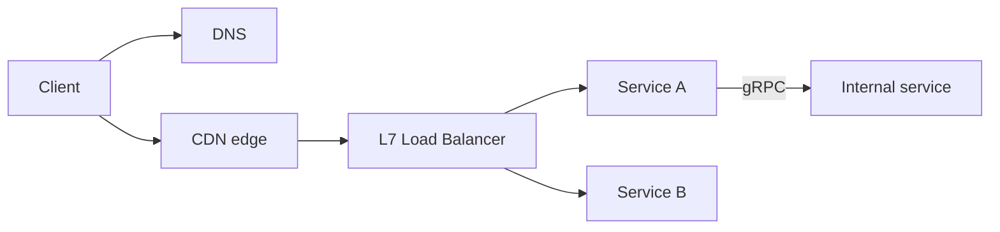

# Networking Essentials

What you need to reason about how a request travels from client to service.

## Layers that matter

| Layer | Protocols | Decision |
|---|---|---|
| L4 transport | TCP, UDP, QUIC | TCP for reliability, UDP/QUIC for latency-sensitive media and HTTP/3 |
| L7 application | HTTP/1.1, HTTP/2, HTTP/3, WebSocket, gRPC | Pick by interaction pattern |

## Choosing a communication style

| Need | Use | Notes |
|---|---|---|
| Request/response CRUD | REST over HTTP | Default |
| Internal low-latency RPC | gRPC (HTTP/2, protobuf) | Streaming, schema contracts |
| Server push, one direction | SSE | Simple, auto-reconnect, through proxies |
| Bidirectional real-time | WebSocket | Stateful connections, harder to scale |
| Unreliable real-time media | UDP/WebRTC | Loss tolerated |

## Load balancing

- **L4** (TCP): fast, no content awareness. **L7** (HTTP): routing by path/header, TLS termination, retries.
- Algorithms: round robin, least connections, consistent hashing (for cache affinity or sticky state).
- Health checks plus connection draining on deploy.
- Long-lived connections (WebSocket) need LB awareness: connections are not rebalanced automatically after scale-out.

## DNS, CDN, regions

- DNS gives geo/latency-based routing and failover. TTL bounds how fast you can fail over.
- CDN caches static and cacheable responses near users; also absorbs DDoS and TLS handshakes.
- Multi-region: route users to the nearest region; decide per dataset whether it is single-writer or multi-writer.

## Gotchas

- Connection setup (DNS, TCP, TLS) costs several RTTs. Reuse connections, use keep-alive and HTTP/2.
- Timeouts must be set at every hop, with total budget less than the client timeout.
- WebSocket servers hold state per connection: plan for reconnect storms after a deploy.
- Cross-AZ and cross-region traffic costs money and adds latency.
