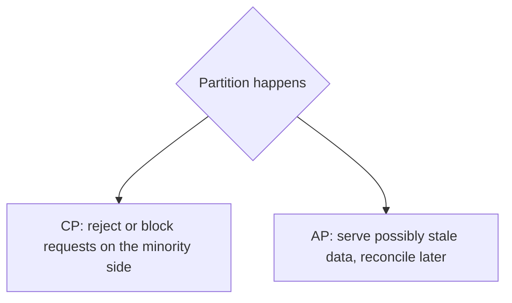

# CAP Theorem

During a **network partition** a distributed system must choose between **Consistency** (every read sees the latest write or an error) and **Availability** (every request gets a non-error response). Partitions are unavoidable, so the real choice is C vs A *when a partition happens*.

## PACELC: the fuller picture

If **P**artition: choose **A** or **C**. **E**lse (normal operation): choose **L**atency or **C**onsistency.

| System | During partition | Normally |
|---|---|---|
| Spanner, etcd, ZooKeeper | C | C (higher latency) |
| Cassandra, DynamoDB (default) | A | L |
| Cosmos DB | Tunable | Tunable (5 levels) |
| PostgreSQL single primary | C | C |

## How to decide per feature

| Feature | Choice | Why |
|---|---|---|
| Payments, inventory at checkout, booking a seat | Consistency | Double-spend and overselling are unacceptable |
| Feed, likes, view counts, presence | Availability | Staleness is invisible or tolerable |
| Chat message ordering within a conversation | Consistency per conversation | Order matters locally, not globally |

Real systems mix both: strongly consistent core (orders) and eventually consistent edges (recommendations, counters).

## Techniques to live with AP

- Last-write-wins (simple, loses writes), version vectors, CRDTs (counters, sets).
- Read repair and anti-entropy to converge replicas.
- Quorums: with `N` replicas, `R + W > N` gives read-your-latest-write on the quorum path.

## Gotchas

- CAP "consistency" means linearizability, not ACID consistency.
- Do not say "CA system". A single-node DB is not partition tolerant by definition, and a distributed one must handle partitions.
- State the choice **per operation** and say what the user sees during the partition.
