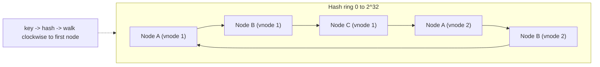

# Consistent Hashing

Distribute keys over nodes so that adding or removing a node moves only about `1/N` of the keys, unlike `hash(key) mod N` which remaps almost everything.

## The ring

1. Hash nodes onto a ring. Hash each key onto the same ring.
2. A key belongs to the first node clockwise from its position.
3. Node added: it takes over only the arc before it. Node removed: its arc goes to the next node.

## Virtual nodes

Each physical node owns many points (e.g. 100-256 vnodes).

- Evens out load (otherwise arcs are uneven).
- Lets stronger machines own more vnodes (weighting).
- Failure spreads the dead node's load over many nodes, not just one neighbor.

## Replication on the ring

Store each key on the next `R` distinct physical nodes clockwise (Dynamo, Cassandra). Skip vnodes of the same host or rack.

## Where it is used

| System | Use |
|---|---|
| Cassandra, DynamoDB | Data placement |
| Memcached/Redis clients, Redis Cluster (hash slots, a variant) | Cache partitioning |
| Load balancers | Sticky routing by key |
| CDNs | Content-to-edge mapping |

## Alternatives

- **Fixed slots** (Redis Cluster: 16384 slots): move slots, not hash points. Simpler ops.
- **Rendezvous (HRW) hashing**: pick node with highest `hash(key, node)`. No ring state, great for small clusters.

## Gotchas

- Hot keys are not solved by hashing; a single popular key still lands on one node.
- Membership changes must propagate consistently (gossip or a coordinator), or clients disagree about ownership.
- When a node joins, warm it (stream data) before it serves reads, or you create misses/stale reads.
