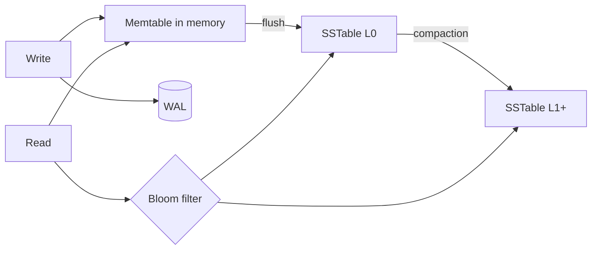

# Database Indexing

An index trades write cost and storage for faster reads. Know the structures, and know how to read a query plan.

## Structures

| Index | Structure | Best for | Weakness |
|---|---|---|---|
| B-tree / B+tree | Balanced sorted tree | Equality, range, ORDER BY (Postgres, MySQL) | Random write I/O |
| LSM tree | Memtable + sorted immutable files, compaction | Write-heavy (Cassandra, RocksDB) | Read amplification, compaction cost |
| Hash | Hash table | Exact-match lookups | No ranges |
| Inverted | Term -> postings list | Full-text search (Elasticsearch) | Costly updates |
| Geospatial | Geohash, quadtree, R-tree, H3 | Nearby queries | Boundary cases, hot cells |
| Bloom filter | Probabilistic set | "Definitely not present" checks | False positives |

## Rules of thumb

- Index columns used in `WHERE`, `JOIN`, `ORDER BY`.
- **Composite index** order: equality columns first, then range, then sort. `(a, b)` serves `a` and `a,b`, not `b` alone.
- **Covering index** includes all selected columns so the table is never touched.
- **Partial index** (`WHERE status = 'active'`) keeps the index small.
- Low-cardinality columns (boolean) make poor standalone indexes.

## Cost

Every index adds write amplification and memory pressure. Over-indexing a write-heavy table is a common production problem.

## Secondary indexes in distributed stores

| Type | Behavior |
|---|---|
| Local (per partition) | Cheap writes, queries scatter to all partitions |
| Global | Queries hit one partition, writes are cross-partition and often async/stale |

Often better: a denormalized table keyed by the second access path.

## Gotchas

- Functions on indexed columns (`lower(email)`) bypass the index unless you index the expression.
- Big offset pagination defeats indexes; use keyset pagination.
- Build indexes online (`CREATE INDEX CONCURRENTLY`) on live tables.
- Verify with `EXPLAIN ANALYZE` instead of guessing.
