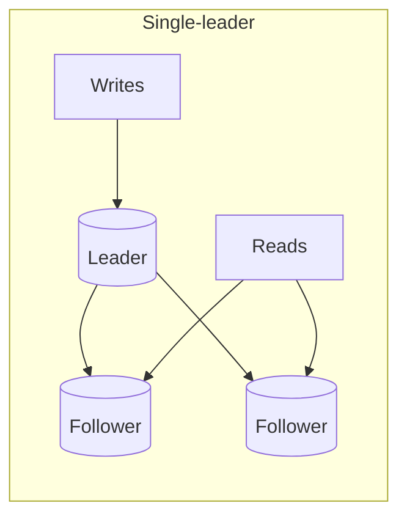

# Replication and Consistency Models

Replication gives availability, durability and read scale. Every replication scheme answers: who accepts writes, and when is a write "done"?

## Topologies

| Topology | Writes | Pros | Cons |
|---|---|---|---|
| Single-leader | One node | Simple, strong ordering | Leader is write bottleneck and failover point |
| Multi-leader | Several (e.g. per region) | Local writes, regional resilience | Conflict resolution needed |
| Leaderless (Dynamo style) | Any replica with quorum | No failover, high availability | Sloppy consistency, read repair |

## Sync vs async replication

| Mode | Durability | Latency |
|---|---|---|
| Synchronous | No loss on leader failure | Slower, blocks on slowest replica |
| Asynchronous | May lose recent writes on failover | Fast |
| Semi-sync (1 sync follower) | Good compromise | Moderate |

## Quorums (leaderless)

With `N` replicas, write to `W`, read from `R`. If `R + W > N`, reads overlap the latest write. Typical `N=3, W=2, R=2`. Higher `W` is slower and less available on writes; lower `R` is faster but staler.

## Consistency models (strong to weak)

| Model | Guarantee |
|---|---|
| Linearizable | Behaves like one copy, real-time order |
| Sequential | Everyone sees the same order |
| Causal | Cause precedes effect everywhere |
| Read-your-writes | You see your own writes |
| Monotonic reads | Never see time go backwards |
| Eventual | Replicas converge if writes stop |

Pick the weakest model that keeps the product correct. Cosmos DB exposes five of these levels directly.

## Conflict resolution

- Last-write-wins by timestamp (simple; clock skew can drop data).
- Version vectors with app-level merge.
- CRDTs for counters, sets, collaborative text.
- Avoid conflicts by assigning a single home region per record.

## Failover

- Detect with heartbeats plus consensus (Raft/Paxos, etcd) to avoid split brain.
- Promote the most up-to-date replica; fence the old leader.
- Replication lag matters for RPO. Monitor it as an SLI.

## Gotchas

- Reading from a follower right after a write breaks read-your-writes; route that user to the leader for a short window.
- Replication is not a backup. A bad `DELETE` replicates instantly.
- Cross-region sync replication adds the full RTT to every write.
