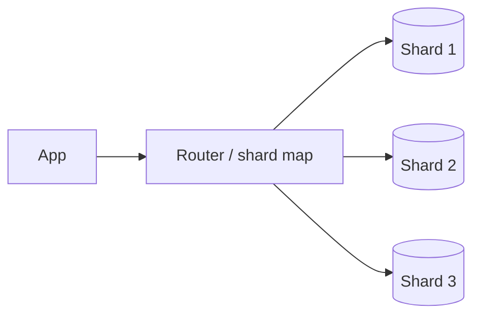

# Sharding

Sharding splits data across nodes so that storage and write throughput scale horizontally. Do it only after vertical scaling, read replicas and caching are insufficient.

## Strategies

| Strategy | How | Pros | Cons |
|---|---|---|---|
| Hash | `hash(key) mod N` or consistent hashing | Even distribution | Range scans hit all shards |
| Range | Key ranges per shard | Efficient range queries | Hot spots (monotonic keys) |
| Directory | Lookup table key -> shard | Flexible, rebalance one tenant | Lookup is a SPOF and bottleneck |
| Geo | By region | Locality, residency | Uneven load |

Use **consistent hashing** (or a fixed number of virtual shards, e.g. 1024 logical shards mapped to nodes) so that adding nodes moves little data.

## Choosing the shard key

- High cardinality, evenly distributed, present in most queries.
- Matches the dominant access pattern so queries hit one shard.
- Examples: `user_id` for user data, `tenant_id` for SaaS, `chat_id` for messaging.

## Problems you will be asked about

| Problem | Approach |
|---|---|
| Hot shard (celebrity) | Split the key (`id#bucket`), dedicated shard, cache in front |
| Cross-shard query | Scatter-gather, or maintain a secondary index/denormalized view |
| Cross-shard transaction | Avoid by colocating; else saga or two-phase commit |
| Rebalancing | Virtual shards, online migration with dual-write then cutover |
| Resharding | Fixed logical shard count makes it a placement problem, not a rehash |

## Gotchas

- Auto-increment IDs per shard collide; use globally unique IDs (Snowflake, ULID).
- Joins across shards are expensive; denormalize or accept scatter-gather.
- Shard-aware backups, schema migrations and monitoring are operational costs. Name them.
