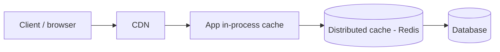

# Caching

Caching trades freshness for latency and load. Use it when reads dominate and staleness is tolerable.

## Where to cache

| Layer | Good for | Risk |
|---|---|---|
| Client / browser | Static assets, config | Hard to invalidate |
| CDN | Public, cacheable content | Purge latency |
| In-process | Tiny hot data, config | Inconsistent between instances |
| Distributed (Redis) | Shared hot data, sessions | Network hop, stampede |

## Patterns

| Pattern | Flow | Trade-off |
|---|---|---|
| Cache-aside | App reads cache, on miss loads DB and fills | Simple; stale until TTL or invalidation |
| Read-through | Cache loads from DB itself | Cleaner app code |
| Write-through | Write cache and DB together | Consistent reads, slower writes |
| Write-back | Write cache, flush to DB later | Fast, risk of data loss |
| Write-around | Write DB only | Avoids cache pollution, first read misses |

Default: **cache-aside with TTL**.

## Invalidation

- TTL plus jitter (avoid synchronized expiry).
- Explicit delete on write (delete, do not update, to avoid races).
- Versioned keys (`user:42:v7`) to avoid invalidation entirely.
- Event-driven invalidation from CDC.

## Eviction

LRU for general use, LFU for stable popularity, TTL for time-bound data. Size memory to the hot set, not the full dataset.

## Failure modes

| Problem | Mitigation |
|---|---|
| Stampede (hot key expires) | Request coalescing, per-key lock, early/probabilistic refresh |
| Penetration (misses for nonexistent keys) | Negative caching, Bloom filter |
| Avalanche (mass expiry or cache down) | TTL jitter, replicas, rate-limit DB fallback |
| Hot key | Local replica of the key, key splitting (`key#0..N`) |

## Gotchas

- Do not cache what you cannot afford to be stale (balances, inventory at checkout).
- A cache is not a source of truth. The system must survive a cold cache without melting the database.
- Measure hit ratio and eviction rate; a low ratio means a wasted hop.
