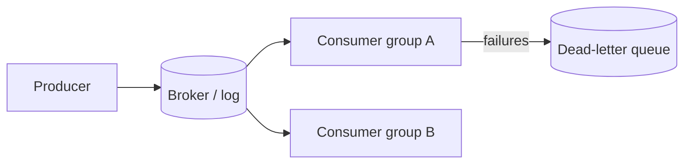

# Message Queues and Streaming

Asynchronous messaging decouples producers from consumers, absorbs bursts and enables retries.

## Queue vs log

| | Queue (SQS, RabbitMQ) | Log/stream (Kafka, Kinesis, Event Hubs) |
|---|---|---|
| Message after consume | Removed | Retained, replayable |
| Consumers | Compete for messages | Each group reads independently |
| Ordering | Best effort or FIFO queue | Per partition |
| Best for | Task distribution, work queues | Event streams, CDC, multiple subscribers, reprocessing |

Technology picks and feature comparison: [Choosing a Messaging Technology](../../03-key-technologies/03-messaging-and-streaming/choosing-a-messaging-technology.md).

## Delivery semantics

| Semantics | Meaning | Reality |
|---|---|---|
| At-most-once | May lose | Fire and forget |
| At-least-once | May duplicate | Default; **make consumers idempotent** |
| Exactly-once | Effect applied once | Achieved as at-least-once plus idempotent or transactional processing |

## Ordering and partitioning

- Order is guaranteed only **within a partition**. Choose the key (e.g. `chat_id`, `order_id`) so things that must be ordered share a partition.
- Max consumer parallelism per group = number of partitions.
- Hot key means hot partition.

## Reliability patterns

- **Ack after processing**, with visibility timeout / commit offset after the side effect.
- **Retry with backoff**, then **dead-letter queue** after N attempts; alert on DLQ depth.
- **Outbox pattern**: write the event in the same DB transaction as the state change, relay it to the broker. Avoids dual-write inconsistency.
- **Idempotent consumers**: dedupe by message ID or make the operation naturally idempotent.
- **Backpressure**: bounded queues, consumer lag alerts, autoscale on lag.

## When to use async

Use for work that does not need to finish before responding (emails, transcoding, fan-out, indexing). Do **not** use to hide a synchronous requirement.

## Gotchas

- Poison messages block a partition if you retry in place. Park them on a retry/DLQ topic.
- Rebalancing causes pauses and duplicates. Keep processing idempotent.
- Schema evolution: use a schema registry and backward-compatible changes.
- Monitor consumer lag, oldest message age and DLQ size.
