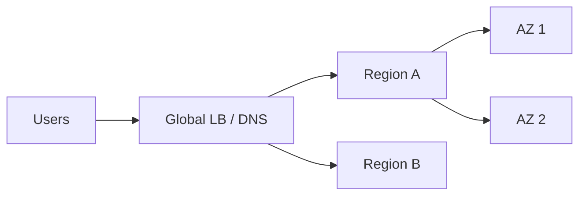

# Observability and Reliability

"How would you know it works, and what happens when it doesn't?" is a standard Staff-level closing question.

## Three pillars

| Signal | Use | Example |
|---|---|---|
| Metrics | Trends, alerting, SLOs | RPS, error rate, p99 latency, queue lag |
| Logs | Detail per event | Structured JSON with request ID |
| Traces | Request path across services | Trace ID propagated through every hop |

## SLI / SLO / error budget

- **SLI**: measured indicator (e.g. successful redirects / total).
- **SLO**: target (99.9% over 30 days, p99 < 100 ms).
- **Error budget** = 1 - SLO. When spent, freeze risky releases and fix reliability.
- Alert on **symptoms** (user-visible SLO burn), not causes (CPU high).

Use the **RED** method for services (Rate, Errors, Duration) and **USE** for resources (Utilization, Saturation, Errors).

## Reliability building blocks

| Practice | Effect |
|---|---|
| Redundancy across AZs/regions | Survive zone or region loss |
| Health checks, autoscaling, self-healing | Recover without humans |
| Graceful degradation | Serve reduced function (stale feed instead of error) |
| Timeouts, retries, breakers | Contain dependency failures |
| Canary and progressive rollout, feature flags | Limit blast radius, fast rollback |
| Backups plus tested restore | Real durability (replication is not a backup) |
| Chaos and game days | Prove failover works |

## DR terms

- **RPO**: how much data you can lose. **RTO**: how long you can be down.
- Strategies by cost: backup/restore, pilot light, warm standby, active-active.

## What to monitor in common components

| Component | Key signals |
|---|---|
| API tier | RPS, 5xx rate, p50/p99 latency, saturation |
| Cache | Hit ratio, evictions, memory, latency |
| Database | Replication lag, connections, slow queries, disk |
| Queue/stream | Consumer lag, oldest message age, DLQ depth |
| Search | Query latency, indexing lag, heap pressure |

## Gotchas

- High-cardinality metric labels (user ID) blow up the metrics store; put them in logs or traces.
- Sample traces (head or tail-based) to control cost.
- Dashboards without alerts and runbooks do not reduce downtime.
- Every deep dive should end with: the failure mode, how you detect it, how you recover.
