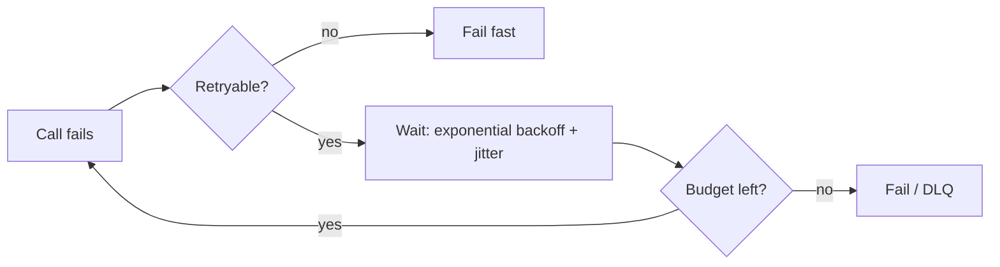

# Rate Limiting, Idempotency and Retries

Three controls that keep distributed systems stable when clients, networks and dependencies misbehave.

## Rate limiting

Protect capacity, enforce fairness and control cost.

| Algorithm | Idea | Pros | Cons |
|---|---|---|---|
| Fixed window | Counter per time window | Simple | Burst at window edges (2x) |
| Sliding window log | Store timestamps | Accurate | Memory heavy |
| Sliding window counter | Weighted previous + current window | Good accuracy, cheap | Approximate |
| Token bucket | Refill rate, burst capacity | Allows bursts, the common default | Needs atomic update |
| Leaky bucket | Constant outflow | Smooth output | No bursts |

**Where**: edge/API gateway for coarse limits, service level for per-tenant limits. **Key**: user ID, API key, IP (fallback), or tenant. **State**: Redis with an atomic Lua script, or local counters plus periodic sync for approximate global limits.

Respond with `429` and `Retry-After`. Fail open or closed depending on risk (login: closed; public reads: open).

## Idempotency

An operation is idempotent when repeating it has the same effect as doing it once. Required because retries are unavoidable.

- Client sends an `Idempotency-Key` (UUID) with each mutation.
- Server stores `key -> response` atomically with the effect (unique constraint) for a TTL.
- A duplicate returns the stored response; a concurrent duplicate waits or gets `409`.
- Naturally idempotent designs: `PUT` with full state, upsert by natural key, set-based updates instead of increments.

## Retries

- Retry only transient errors (timeouts, 503, 429). Never retry 4xx validation errors.
- **Exponential backoff with jitter** prevents synchronized retry waves.
- **Retry budget**: cap retries at about 10% extra traffic; retry at one layer only, otherwise attempts multiply (3 layers x 3 tries = 27).
- **Timeouts** on every call; propagate a deadline downstream.

## Protecting dependencies

| Pattern | Purpose |
|---|---|
| Circuit breaker | Stop calling a failing dependency, fail fast, probe to recover |
| Bulkhead | Isolate resource pools so one dependency cannot exhaust all threads |
| Load shedding | Drop low-priority work when saturated |
| Hedged requests | Send a second request after p95 to cut tail latency (only for idempotent reads) |

## Gotchas

- Retry storms after an outage can keep a recovering service down; use jitter, budgets and breakers.
- Idempotency keys must be scoped per user and operation, and stored durably with the effect.
- Rate limiter outage must not take down the API; set a local fallback.
