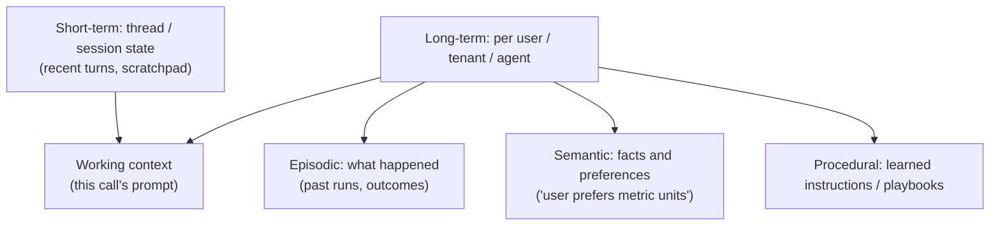

# Agent Memory and Context Engineering

The model is stateless. Everything it "remembers" is what you put in the **context window** on this call. Memory design is deciding what to store, how to retrieve it and what to include.

## Memory tiers

| Tier | Lifetime | Store | Retrieval |
|---|---|---|---|
| Working | One model call | Prompt | n/a |
| Short-term | Session or thread | Key-value / document DB, cache | Load last N turns or summary by `threadId` |
| Long-term semantic | Months to forever | Document DB plus vector index | Similarity + metadata filter by `userId` |
| Episodic | Days to months | Document DB / log store | By recency, similarity, outcome |
| Shared knowledge | Org-wide | RAG index | See [RAG](embeddings-vector-search-rag.md) |

Do not confuse **memory** (learned about the user or the agent's past) with **knowledge** (corpus documents). They have different owners, privacy rules and lifecycles.

## Context budget

Allocate the window like a memory budget (example for a 128k window, but aim to use far less):

| Slot | Typical share | Notes |
|---|---|---|
| System prompt + policies | 2-5% | Stable prefix, cache-friendly |
| Tool schemas | 5-15% | Load only relevant tools; large catalogs hurt accuracy |
| Memory (profile, facts) | 5-10% | Retrieved top-k, not everything |
| Retrieved documents | 20-40% | Top reranked chunks |
| Conversation history | 20-40% | Recent turns verbatim, older summarized |
| Output reserve | 5-10% | Leave room to answer |

Quality often drops before the window is full, and cost scales with every token. **Smaller, relevant context beats larger context.**

## Managing history

| Technique | Notes |
|---|---|
| Sliding window | Keep last N turns; simplest; loses early facts |
| Rolling summary | Summarize older turns into a running summary; risk of drift and loss, keep key facts pinned |
| Fact extraction | Extract durable facts into long-term memory, drop the chatter |
| Tool-result trimming | Replace large tool outputs with a reference or digest after use |
| Sub-agent isolation | Give each sub-agent a fresh, small context and return only a summary |

## Write path: what to remember

1. **Extract** candidate memories after a turn or run (LLM or rules): fact, preference, outcome.
2. **Decide**: ignore, add, update, or delete (merge duplicates, resolve conflicts, newer wins unless pinned).
3. **Store** with `userId`, `scope`, `source`, `createdAt`, `confidence`, `ttl`, optional embedding.
4. **Consolidate** asynchronously: merge, summarize episodes into semantic facts, decay unused memories.

Run extraction **off the hot path** (queue) so chat latency is unaffected.

## Read path

- Retrieve by **semantic similarity + recency + importance**, filtered by `userId` and scope.
- Cap to top-k, inject in a labeled block ("Known about this user"), and let the model ignore it if irrelevant.
- Cache the profile block per session.

## Privacy, safety and correctness

| Concern | Control |
|---|---|
| Cross-user leakage | Mandatory `userId`/tenant filter in the data layer, not in the prompt |
| Right to be forgotten | Delete by `userId` across store, index, summaries and backups (TTL) |
| PII and secrets in memory | Classify and redact before storing; avoid storing secrets |
| Memory poisoning (an attacker plants instructions) | Only write memories from trusted turns; store facts, not instructions; show and let users edit memories |
| Stale or wrong facts | Timestamps, confidence, user-visible memory with delete |

## Failure modes

- Summaries drift and fabricate facts. Keep source turns for audit and re-summarize periodically.
- Unbounded memory growth. Use TTL, decay and consolidation.
- Retrieval brings irrelevant memories that distract the model. Filter by threshold, not just top-k.
- Concurrent runs write conflicting memories. Use versioned upserts per `(userId, key)`.

## Interview cheat-sheet

- Say: "Thread state in a document store loaded by `threadId`; extraction runs async to a per-user long-term store with embeddings; reads are top-k by similarity and recency filtered by user; summaries for old turns; TTL and delete-by-user for privacy."
- Related: [Tool Use](tool-use-mcp-and-agent-protocols.md) (tool-schema budget), [Security](agent-security-safety-guardrails.md).
