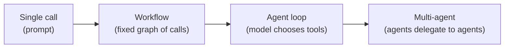

# Agent Orchestration Patterns

An agent system is a **control loop around a model**. Pick the least autonomous pattern that solves the problem: workflows (code decides the path) are cheaper, faster and more predictable than agents (the model decides the path).

## Spectrum of autonomy



Cost, latency, variance and risk all rise to the right. Move right only when an eval shows the simpler pattern fails.

## Core patterns

| Pattern | Shape | Use when | Watch out |
|---|---|---|---|
| **Prompt chaining** | Step 1 then step 2 then step 3, with validation gates | Task decomposes into fixed stages (draft, translate, format) | Errors compound; validate between steps |
| **Routing** | Classifier sends input to a specialized handler | Distinct input categories (billing vs tech support), mixed cost tiers | Misroutes; add a fallback route |
| **Parallelization** | Fan-out independent calls, then aggregate (sectioning or voting) | Independent subtasks, or need multiple opinions | Cost multiplies; aggregation logic |
| **Orchestrator-workers** | A planner splits the task dynamically, workers execute, results are merged | Subtasks are not known in advance (research, code changes across files) | Planner quality; worker context isolation |
| **Evaluator-optimizer** | Generator then critic, loop until good | Clear quality criteria and revision helps (writing, code with tests) | Needs a stop condition; critic can be wrong |
| **ReAct agent loop** | Reason, act (tool), observe, repeat | Open-ended tasks with tools | Loops, drift, cost; needs hard limits |
| **Plan-and-execute** | Plan once, execute steps (re-plan on failure) | Long tasks where re-reasoning every step is wasteful | Stale plans |
| **Multi-agent (handoff / supervisor)** | Specialists with their own tools and context | Separable domains, context too big for one agent | Coordination overhead, hard to debug; often a workflow is enough |
| **Human-in-the-loop** | Pause for approval, input or correction | Irreversible or high-risk actions | Needs durable pause and resume |

Rule of thumb: start with a single agent plus good tools, then a workflow for the parts that must be reliable, and only then multiple agents.

## The agent loop, with the limits that make it safe

```text
while not done:
    context = assemble(system, memory, history, observations)    # token budget
    action  = model(context)                                      # timeout, retry, fallback
    if action is final: break
    validate(action); authorize(action); maybe_request_approval(action)
    obs = execute_tool(action, idempotency_key)                   # timeout, sandbox
    record(step, tokens, cost, latency)                           # trace + durable state
    enforce(max_steps, max_tokens, max_cost, max_wall_time, loop_detection)
```

Every loop needs: **max steps, token and cost budget, wall-clock limit, repeat-detection, a cancel signal and a defined behavior on exhaustion** (return partial result, escalate to a human).

## Durable execution (reliability of long-running runs)

An agent run may last minutes to days and spans many unreliable calls. A process crash must not lose progress or repeat side effects.

| Technique | Detail |
|---|---|
| **Persist state after each step** | Run record: input, steps, tool results, plan, status. Resume from the last completed step |
| **Workflow engine with event-sourced history** | Durable Task / Temporal-style: replay deterministic orchestration code, activities do the I/O (model and tool calls) |
| **Idempotency keys on every tool call** | Replays and retries must not double-execute |
| **Timeouts and heartbeats on activities** | Detect hung model or tool calls |
| **Saga / compensation** | Undo completed side effects when a later step fails (cancel booking, refund) |
| **Async API** | `POST /runs` returns `runId`; poll, stream or webhook for status |
| **Durable human waits** | Wait for an external event or approval without holding a thread or connection |

Orchestration code that is replayed must be deterministic: no wall-clock reads, no random, no direct I/O. Put the non-deterministic model call inside an activity and **record its result**, so replay reuses it instead of calling again. See [Durable Orchestration](../../03-key-technologies/04-agentic-platform/durable-orchestration.md).

## Human-in-the-loop

| Mode | Example |
|---|---|
| Approve before action | "Send this refund of $400?" |
| Edit then continue | Human fixes a draft plan |
| Escalate on low confidence | Hand to support agent with context summary |
| Review after (audit) | Sample and grade outcomes |

Approval requests are **durable events with a timeout and a default** (deny or escalate), tied to the run and the identity of the approver.

## Multi-agent design notes

- Give each agent a narrow role, its own tools and a **small context**; pass summaries and structured results between them, not raw transcripts.
- Prefer a **supervisor** with explicit handoffs over free-form agent chat, which is hard to bound.
- Shared state lives in a store (blackboard), with ownership per key.
- Cap total depth and fan-out of delegation. Sub-agents multiply cost (a research task can use 10-20x the tokens of a chat).

## Failure modes

| Failure | Mitigation |
|---|---|
| Infinite or very long loops | Step, token, cost and time budgets; loop detection |
| Error compounding across steps | Validate intermediate outputs, checkpoints, re-plan |
| Wrong tool or hallucinated arguments | Schema validation, fewer tools, evals |
| Duplicate side effects after retry or replay | Idempotency keys, outbox, compensation |
| State lost on crash | Durable run state, resumable workflow |
| Cost blowups | Per-run and per-tenant budgets, cheaper models for easy steps |
| Untraceable behavior | Trace every step with inputs, outputs, tokens and cost |

## Interview cheat-sheet

- Say: "I'd start with a workflow, give the agent loop hard budgets, run it on a durable workflow engine so a crash resumes at the last step, make every tool call idempotent, and require approval for irreversible actions."
- Choosing between patterns: [Agent Pattern Decision Cheat-Sheet](agent-pattern-decision-cheat-sheet.md).
- Related: [Harness Engineering](harness-engineering.md), [Tool Use and MCP](tool-use-mcp-and-agent-protocols.md), [Message Queues and Streaming](../03-performance-and-reliability/message-queues-and-streaming.md), [Rate Limiting, Idempotency and Retries](../03-performance-and-reliability/rate-limiting-idempotency-retries.md).
