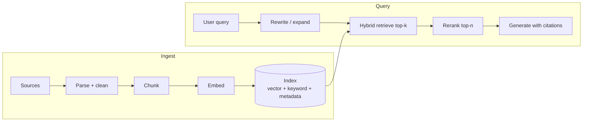

# Embeddings, Vector Search and RAG

Retrieval-augmented generation (RAG) grounds a model in your data: retrieve relevant passages, put them in the prompt, generate an answer with citations. It is a **search system with an LLM on the end**, so most quality problems are retrieval problems.

## Pipeline

## Embeddings

- A model maps text (or images) to a vector of ~10^2 to 10^4 dimensions; **similar meaning means nearby vectors** (cosine or dot product).
- Storage: `chunks x dimensions x bytes`. 10M chunks x 1536 dims x 4 B (float32) is ~60 GB. Quantization (int8, binary) cuts this 4-32x with small recall loss.
- Pin the embedding model version. Changing it means **re-embedding everything**; plan a blue/green index.
- Query and document must use the same model (and the same input prefix conventions, if the model needs them).

## Approximate nearest neighbor (ANN) indexes

| Index | Idea | Trade-off |
|---|---|---|
| Flat (exact) | Compare to all vectors | Perfect recall, fine up to ~10^5-10^6 vectors |
| HNSW | Layered proximity graph | Fast, high recall, **memory heavy**, slower inserts |
| IVF (+PQ) | Cluster, search nearest clusters, compress | Lower memory, tune `nprobe`, recall drops with compression |
| DiskANN-style | Graph on SSD with compressed vectors in RAM | Billion scale at lower memory cost |

Tuning knobs trade **recall vs latency vs memory**. Measure recall@k against an exact baseline on your data.

## Chunking

| Strategy | Notes |
|---|---|
| Fixed size with overlap (e.g. 300-800 tokens, 10-20% overlap) | Simple default |
| Structure-aware (headings, sections, tables, code blocks) | Better answers, needs parsing |
| Parent-child (retrieve small, return the parent section) | Precise match, enough context |
| Contextual chunks (prepend doc title and summary to each chunk) | Fixes chunks that lose meaning in isolation |

Always store metadata: source, section, page, ACL, timestamp, version, tenant.

## Hybrid search and reranking

- **Vector** search finds paraphrases; **keyword (BM25)** finds exact terms, IDs and acronyms. Use both and merge with **reciprocal rank fusion**.
- A **cross-encoder reranker** scores the top 50-100 candidates against the query and keeps the best 5-10. It adds ~50-300 ms and is usually the biggest quality gain per dollar.
- Query rewriting (expand, decompose multi-hop questions, resolve pronouns from chat history) before retrieval.
- Metadata filters (tenant, date, doc type) apply **before or during** ANN, not after, or you lose recall.

## Permissions (the enterprise trap)

Users must only see what they are allowed to read.

| Approach | Notes |
|---|---|
| Store ACL group IDs on each chunk, filter at query time using the caller's groups | Standard; keep ACL sync fresh |
| Per-tenant index or partition | Strongest isolation, more indexes to run |
| Post-filter results | Leaks risk and low recall; avoid as the only control |

The ACL comes from the **end user's identity**, never the agent's service identity.

## Freshness

| Need | Mechanism |
|---|---|
| Near-real-time | Change feed / CDC / webhook triggers incremental re-chunk and upsert |
| Daily | Scheduled indexer with change detection |
| Deletes | Tombstones and TTL; deleted documents must leave the index (compliance) |

Version the index. Track `indexed_at` per document and alert on lag.

## Beyond naive RAG

| Pattern | Use |
|---|---|
| Agentic retrieval | Model plans sub-queries, runs them in parallel, merges results; better on complex questions, costs more calls |
| Multi-hop | Iterate retrieve, read, retrieve again |
| GraphRAG | Entity and relation graph for global or relationship questions |
| Long context instead of RAG | Fine for small corpora; expensive and worse at precision for large ones |
| Self-check | Verify claims against retrieved sources, abstain if unsupported |

## Failure modes

| Failure | Mitigation |
|---|---|
| Right doc not retrieved | Hybrid search, rewrite, better chunks, evaluate recall@k |
| Retrieved but ignored or misused | Fewer, better chunks; reranking; "lost in the middle" ordering |
| Hallucinated citation | Return chunk IDs from retrieval, validate that citations exist in the context |
| Stale or deleted content | Incremental indexing, tombstones |
| Permission leak | Query-time ACL filter, tests with cross-tenant probes |
| Prompt injection inside documents | Treat retrieved text as untrusted data (see [Security](agent-security-safety-guardrails.md)) |

## Evaluate retrieval and generation separately

- Retrieval: recall@k, MRR, nDCG on a labeled query set.
- Generation: groundedness (claims supported by context), answer relevance, citation accuracy. See [Evaluation](evaluation-and-observability-for-llm-systems.md).

## Interview cheat-sheet

- Say: "Hybrid retrieval with metadata and ACL filters, rerank the top 50 to 8, parent-child chunks, incremental indexing off the change feed, and evals on recall@k and groundedness."
- Compare vector stores in [Vector Databases](../../03-key-technologies/01-databases/vector-databases.md); Azure option in [Azure AI Search](../../03-key-technologies/02-caching-and-search/azure-ai-search.md).
