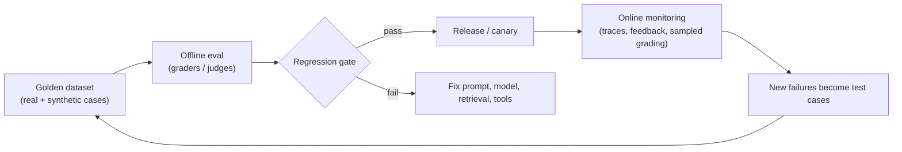
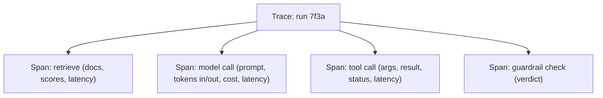

# Evaluation and Observability for LLM Systems

Traditional tests assert exact outputs. LLM systems are non-deterministic, so you measure **distributions of quality** on representative data and watch production continuously. No eval set means no safe way to change a prompt, model or tool.

## Evaluation loop

## What to measure

| Layer | Metrics |
|---|---|
| Retrieval | recall@k, MRR, nDCG, context precision |
| Generation | Groundedness (claims supported by context), answer relevance, completeness, citation accuracy, format validity |
| Tool use | Correct tool selected, argument accuracy, unnecessary calls |
| Task (agent) | End-to-end success rate, steps to completion, recovery from tool errors |
| Safety | Injection resistance, refusal correctness, PII leakage, harmful-content rate |
| Operational | TTFT, latency p50/p99, tokens and **cost per task**, error and timeout rate, 429 rate |
| User | Thumbs up/down, regenerations, escalation to human, task abandonment |

## Graders

| Method | Strength | Weakness |
|---|---|---|
| Code / rule checks (JSON valid, regex, SQL executes, unit tests pass) | Cheap, deterministic | Narrow |
| Reference-based (exact, similarity to gold answer) | Simple | Many valid answers |
| **LLM-as-judge** with a rubric | Scales, flexible | Bias (position, verbosity, self-preference), drift; calibrate against human labels, pin the judge model |
| Human review | Ground truth | Slow and costly; use for calibration and hard cases |
| Pairwise comparison | More reliable than absolute scores | Needs a baseline |

Use a **different or stronger judge** than the system under test, give it a rubric with examples, and measure judge agreement with humans (e.g. Cohen's kappa).

## Datasets

- Seed with real queries (anonymized) and expert-written answers; add synthetic cases for edge conditions.
- Cover **happy paths, ambiguous inputs, adversarial/injection cases, out-of-scope and permission-boundary cases**.
- Version datasets and graders. Track which failures each case guards.
- 100-500 well-chosen cases often beat thousands of noisy ones to start.

## Release gates

- Run the suite on every change to prompts, model versions, retrieval config, tools and guardrails (treat them as code).
- Block on regressions in key metrics beyond a tolerance; account for variance (multiple samples per case).
- Roll out with **canary / A/B** on a traffic slice and compare online metrics. Pin model versions and test upgrades before adopting them.

## Observability

Traces are the primary tool for agents. One **trace per run**, one **span per step**.

| Capture | Why |
|---|---|
| Prompt, response, model and version, parameters | Reproduce and debug |
| Tokens in/out, cost, latency per step | Cost per task and bottlenecks |
| Retrieved chunk IDs and scores | Diagnose retrieval vs generation |
| Tool name, args, result, error | Tool-use failures |
| User and tenant IDs (hashed), feedback | Slice by segment |
| Guardrail decisions | Safety dashboards |

Controls: **redact PII and secrets** before storage, set retention, sample payloads (always keep errors and low-scored runs), and use standard telemetry conventions (OpenTelemetry GenAI semantic conventions) so traces work across tools.

## Dashboards and alerts

| Signal | Alert on |
|---|---|
| Success or groundedness score (sampled online grading) | Drop vs baseline |
| Cost per task and tokens per run | Spike, loop suspected |
| p99 latency and TTFT | SLO burn |
| 429s and provider errors | Capacity or outage |
| Guardrail block rate | Attack or false-positive surge |
| Escalation rate | Quality regression |

Tie these to SLOs, as in [Observability and Reliability](../03-performance-and-reliability/observability-and-reliability.md). Add a runbook for "answer quality dropped": check recent prompt/model/index changes, then retrieval recall, then tool errors.

## Failure modes

| Failure | Mitigation |
|---|---|
| Judge is biased or inconsistent | Calibrate with humans, pairwise, multiple judges |
| Eval set goes stale | Feed production failures back in |
| Overfitting to the golden set | Hold-out set, rotate cases |
| Logging leaks sensitive data | Redaction, access control, retention |
| Eval cost grows | Tiered suites: fast smoke on every commit, full suite nightly |

## Interview cheat-sheet

- Say: "A versioned golden set with rubric-based judges calibrated against humans gates every prompt, model and retrieval change; traces per run with cost and tokens feed dashboards, and failed production runs flow back into the dataset."
- Related: [Harness Engineering](harness-engineering.md) (ablating and gating harness changes), [RAG](embeddings-vector-search-rag.md) (retrieval metrics), [Security](agent-security-safety-guardrails.md) (red-team cases).
