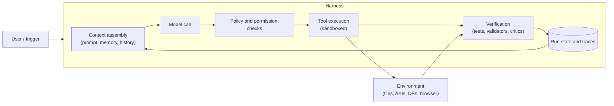

# Harness Engineering

**Agent = model + harness.** The harness is everything around the weights: the loop, prompts, tools, context assembly, permissions, sandbox, state and verification. Two systems with the same model can differ wildly in reliability, cost and safety, because the harness decides what the model sees, what it may do and how its mistakes are caught.

## Where the harness sits

The model proposes; the harness decides, executes, checks and remembers.

## Harness components

| Component | Job | Design notes | See |
|---|---|---|---|
| **Control loop** | Run model, act, observe, repeat | Hard budgets for steps, tokens, cost and wall time; repeat detection; defined exit on exhaustion | [Orchestration](agent-orchestration-patterns.md) |
| **System prompt and instructions** | Role, rules, output contract | Stable prefix for cache hits; versioned like code | [LLM Fundamentals](llm-fundamentals.md) |
| **Tool layer** | Expose actions to the model | Few, well-named tools with strict schemas; errors returned as actionable messages | [Tools and MCP](tool-use-mcp-and-agent-protocols.md) |
| **Context management** | Decide what is in the window each call | Load tools and documents on demand, summarize or trim old turns | [Memory and Context](agent-memory-and-context-engineering.md) |
| **Permissions and approvals** | Limit blast radius | Least privilege per run, allow/deny lists, approval for irreversible actions | [Security](agent-security-safety-guardrails.md) |
| **Sandbox** | Isolate code and file execution | Ephemeral, no ambient credentials, network egress allow-list, CPU and time caps | [Tools and MCP](tool-use-mcp-and-agent-protocols.md) |
| **State and persistence** | Survive crashes, support resume | Checkpoint after each step; idempotency keys on side effects | [Orchestration](agent-orchestration-patterns.md) |
| **Verification** | Catch wrong output before it matters | See next section | [Evals](evaluation-and-observability-for-llm-systems.md) |
| **Observability** | Make runs debuggable | One trace per run, with every model call, tool call, token count and decision | [Evals](evaluation-and-observability-for-llm-systems.md) |

## Feedback loops and verification

An agent improves most when the environment can tell it, quickly and precisely, that it is wrong. Build the check first, then let the loop use it.

| Check | Type | Strength | Weakness |
|---|---|---|---|
| Schema and type validation of tool args and outputs | Deterministic | Cheap, instant, no false positives | Only catches shape errors |
| Tests, linters, compilers, query dry-runs | Deterministic | Ground truth for correctness of code and queries | Needs good coverage; slow suites stall the loop |
| Business-rule validators (limits, balances, policy) | Deterministic | Enforces invariants the model cannot be trusted with | Rules must be maintained |
| Self-check (model re-reads its own answer) | Model-judged | Catches obvious slips | Shares the generator's blind spots |
| Separate critic or evaluator agent | Model-judged | Independent view; good for open-ended quality | Cost, latency, critic can be wrong |
| Human review | Human | Best for high-stakes or ambiguous output | Slow; needs a durable pause |

Rules of thumb:

- Prefer deterministic checks. Use model judges only where no deterministic check exists.
- Return **specific, actionable failure messages** to the model (which test failed, which field is invalid), not "error".
- Bound the repair loop: a max retry count, then escalate or return a partial result.
- Verify against the **real outcome** (the row exists, the file compiles), not the agent's claim that it did the work.

## Long-running work

A task that exceeds one context window needs the harness to carry continuity, because the model carries none.

| Technique | Detail |
|---|---|
| **Initializer step** | First run sets up the plan, a task list and the success criteria, and writes them to durable artifacts |
| **Progress artifacts** | A progress log and task checklist the agent reads at the start of each session and updates at the end |
| **Checkpoints** | Persist run state and a clean working state after each unit of work, so a failed step can roll back or resume |
| **Compaction** | Summarize older history when the window fills; keep decisions, open questions and pending actions verbatim |
| **Context reset with handoff** | Start a fresh context seeded from the progress artifacts when compaction degrades quality |
| **Subagents for isolation** | Delegate a noisy subtask (search, log analysis) to a worker with its own context and return only a summary |
| **One unit of work at a time** | Finish and verify one task before starting the next; avoid half-done states |
| **Durable resume** | Run on a workflow engine so a crash restarts at the last completed step. See [Durable Orchestration](../../03-key-technologies/04-agentic-platform/durable-orchestration.md) |

## Evaluating the harness

Treat harness changes like model changes: they alter behavior and need evals.

- **Hold the model fixed, vary the harness**, then compare success rate, cost per task, latency and steps per run on the same dataset.
- **Ablate components** one at a time (the critic, a tool, the compaction step) to see what each contributes. Remove those that add cost without measurable gain.
- **Gate every harness change** (prompt edit, tool schema change, new limit) behind the regression suite in [Evaluation and Observability](evaluation-and-observability-for-llm-systems.md).
- **Re-test when the model changes.** Scaffolding built to work around a weaker model (heavy planning prompts, forced reflection steps) can become dead weight or even hurt on a stronger one.
- **Separate harness failures from model failures** when reading traces: wrong tool offered, context missing, limit hit, or a check that never ran are harness bugs; a bad plan given good context is a model limit.

## Failure modes

| Failure | Mitigation |
|---|---|
| Too many tools or an overstuffed prompt degrade accuracy | Load tools and context on demand; ablate and prune |
| Agent declares success without doing the work | Verify against the environment, not the agent's report |
| Repair loop never converges | Retry cap, escalation, distinct failure messages |
| Context fills and early decisions are lost | Compaction that preserves decisions; progress artifacts; context reset |
| Harness silently drops errors from tools | Return errors to the model and log them in the trace |
| Over-permissive sandbox or credentials | Least privilege, ephemeral environments, egress allow-list |
| Harness tuned to one model regresses on another | Re-run evals on every model change |
| Unversioned prompt or tool edits break production | Version and release-gate harness config like code |

## Interview cheat-sheet

- Say: "The model is one component. I'd design the harness explicitly: a budgeted loop, a small set of strictly typed tools, on-demand context, sandboxed execution with least privilege, deterministic verification wherever possible, durable state for resume, and evals that gate harness changes as well as model changes."
- Strong deep dive: pick the verification layer or long-running continuity and walk through concrete failure and repair behavior.
- Related: [Orchestration Patterns](agent-orchestration-patterns.md), [Memory and Context Engineering](agent-memory-and-context-engineering.md), [Tools and MCP](tool-use-mcp-and-agent-protocols.md), [Security and Guardrails](agent-security-safety-guardrails.md), [Evaluation and Observability](evaluation-and-observability-for-llm-systems.md).
