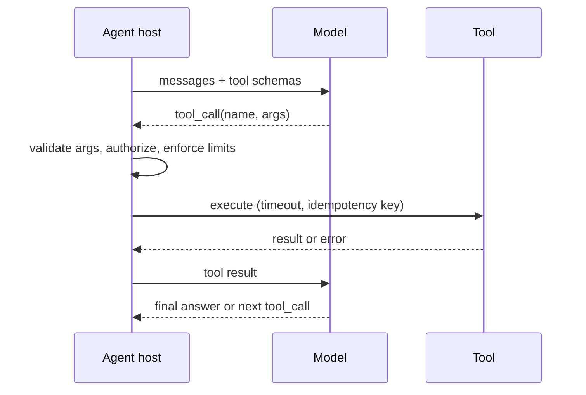

# Tool Use, MCP and Agent Protocols

Tools are how an agent changes the world or fetches fresh data. The model proposes a call, **your code executes it**, and the result goes back into context. The model never runs anything itself.

Protocol facts here track the MCP specification revision `2026-07-28`. Check [modelcontextprotocol.io](https://modelcontextprotocol.io/specification/latest) before relying on details.

## Function calling loop

## Tool design rules

| Rule | Why |
|---|---|
| Few, task-oriented tools with clear names and descriptions | Selection accuracy drops as the catalog grows (tens of tools is a practical ceiling per call) |
| Strict JSON schema, enums, required fields | Fewer malformed calls; validate server-side anyway |
| Return compact, structured results (paginate, summarize) | Tool output eats context and cost |
| Errors are actionable text ("`date` must be ISO 8601") | Lets the model self-correct |
| **Idempotent** or guarded by an idempotency key | Retries and loops must not double-charge or double-send |
| Separate **read** tools from **write** tools; mark side effects | Different approval and permission rules |
| Timeouts, per-tool rate limits, circuit breakers | A slow tool must not stall the whole loop |

## Model Context Protocol (MCP)

An open protocol (JSON-RPC 2.0) that standardizes how an AI **host** connects to **servers** exposing capabilities, so one tool implementation works with many agents.

| Concept | Meaning |
|---|---|
| Host / client / server | App that runs the model, its connector, and the service exposing capabilities |
| **Tools** | Functions the model can invoke |
| **Resources** | Read-only context (files, records) the app or model can load |
| **Prompts** | Reusable templates and workflows chosen by the user |
| **Elicitation** | Server asks the user for more input |
| Extensions (opt-in) | e.g. **Tasks** for long-running operations, MCP Apps for UI |

### Transports

| Transport | Use |
|---|---|
| stdio | Local server launched as a subprocess by the client; credentials come from the environment |
| **Streamable HTTP** | Remote servers: a single MCP endpoint, every message is an HTTP `POST`, reply is JSON or a request-scoped SSE stream |

In the `2026-07-28` revision the protocol is **stateless**: each request carries its protocol version, client info and capabilities in `_meta`, so there is no connection-scoped session or `initialize` handshake, no long-lived GET stream, and closing the response stream cancels the request. Older revisions used `Mcp-Session-Id` and resumable streams; supporting old clients means implementing both eras. The legacy HTTP+SSE transport is deprecated.

Design consequences:

- Any server replica can serve any request, so scale horizontally behind a load balancer with no sticky sessions.
- Selected fields are mirrored into headers (`Mcp-Method`, `Mcp-Name`, and optionally tool parameters) so **gateways can route, rate-limit and authorize without parsing the body**. The server must reject header/body mismatches.
- Server-to-client interactions (sampling, elicitation) come back as an "input required" result that the client answers on a retry, not as separate server-initiated requests.
- Change notifications use an explicit `subscriptions/listen` stream.

### Long-running work: Tasks extension

For work longer than a few seconds, the server returns a durable **task handle** instead of blocking: `working`, `input_required`, `completed`, `failed`, `cancelled`. The client polls (`tasks/get`), supplies input (`tasks/update`) or cancels (`tasks/cancel`), and can resume by `taskId` after a crash. This is the standard fit for approvals and batch jobs.

### Authorization

| Requirement | Detail |
|---|---|
| MCP server is an OAuth 2.1 **resource server** | Publishes Protected Resource Metadata (RFC 9728) so clients discover the authorization server |
| Challenge | `401` with `WWW-Authenticate` pointing at the metadata and the needed `scope` |
| Client registration | Prefer Client ID Metadata Documents; Dynamic Client Registration is deprecated |
| Resource indicator (RFC 8707) | Client sends `resource` in authorization and token requests; tokens are bound to one server |
| **Validate audience** | Server accepts only tokens issued for itself |
| **No token passthrough** | Never forward the client's token to a downstream API; exchange it (on-behalf-of) or use a separate credential |
| Step-up | `403 insufficient_scope` triggers re-authorization with more scopes |
| PKCE, `Origin` validation | Defend against code interception and DNS rebinding |

Authorization is optional in the spec for local stdio; remote servers should always protect their endpoint.

## Other protocols

| Protocol | Purpose |
|---|---|
| **A2A** (agent-to-agent) | Agents discover each other (agent cards), delegate tasks and stream results across vendors and frameworks |
| OpenAPI tools | Wrap existing REST APIs as tools |
| AG-UI and similar | Stream agent events to a UI |

MCP is **agent to tool/data**; A2A is **agent to agent**. They are complementary.

## Execution safety and sandboxing

- Code-execution and shell tools run in **isolated sandboxes** (microVM or hardened container, no ambient credentials, egress allow-list, CPU/memory/time limits, ephemeral filesystem). See the LeetCode breakdown for the same threat model in [LeetCode](../../04-problem-breakdowns/leetcode.md).
- Treat tool descriptions and tool outputs from third-party servers as **untrusted input** (tool poisoning, prompt injection). Pin server versions and review descriptions.
- Enforce least privilege per tool and per user. See [Security](agent-security-safety-guardrails.md).

## Failure modes

| Failure | Mitigation |
|---|---|
| Model picks the wrong tool or bad args | Fewer tools, tool routing, schema validation, examples |
| Infinite tool loops | Max steps and repeated-call detection |
| Slow or flaky tool | Timeout, retry with idempotency key, fallback |
| Confused deputy (agent uses its own broad rights) | Act with the user's delegated identity, scope checks per call |
| Tool catalog drift breaks agents | Versioned tools, contract tests, evals on tool use |

## Interview cheat-sheet

- Say: "Tools sit behind an MCP gateway that terminates OAuth, validates audience, applies per-tenant rate limits and routes on the mirrored headers; servers are stateless; long jobs use the Tasks extension; writes are idempotent and need approval above a risk threshold."
- Related: [Agent Orchestration Patterns](agent-orchestration-patterns.md), [Harness Engineering](harness-engineering.md), [Design an MCP Platform](../../05-agentic-problem-breakdowns/mcp-platform.md).
