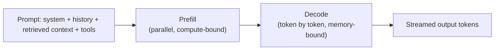

# LLM Fundamentals for System Designers

Treat the model as a **slow, metered, non-deterministic, rate-limited remote dependency**. You do not need the math, only what changes your architecture.

## What a model call looks like

| Term | Meaning | Design impact |
|---|---|---|
| Token | ~4 chars or ~0.75 English words | Unit of cost, quota and latency |
| Context window | Max input + output tokens per call (10^5 to 10^6 today) | Hard cap on history, documents and tool output per turn |
| Prefill | Reading the whole prompt | Cost and latency grow with prompt size |
| Decode | Generating tokens one by one | Latency grows linearly with output length |
| TTFT | Time to first token | What users feel in a chat UI |
| Tokens/s | Decode speed (tens per second per stream) | Sets total time for long answers |

## Latency model

`total latency = queueing + prefill(input tokens) + decode(output tokens) + tool calls + retries`

- Output tokens dominate: a 500-token answer at ~50 tokens/s is ~10 s. **Stream it** so TTFT (about 0.3-2 s) is what the user perceives.
- Reasoning models add hidden "thinking" tokens before the first visible token. They cost more and raise TTFT; use them only where quality pays for it.
- Agents multiply this: 5 sequential model calls of 3 s each is 15 s. Parallelize independent calls and cap steps.

## Cost model

`cost per call = input_tokens x input_price + output_tokens x output_price` (output is typically 3-5x the input price).

| Lever | Effect |
|---|---|
| Prompt caching (stable prefix first) | Cheaper and faster for repeated system prompts, tool schemas and documents |
| Smaller model for easy steps (routing) | 10-50x cheaper per token than a frontier model |
| Trim history, summarize, retrieve only top-k | Cuts input tokens |
| Short structured outputs | Cuts output tokens, the expensive side |
| Batch API for non-interactive work | Large discount, hours of latency |

Budget **cost per task**, not per call. An agent task with 8 calls averaging 6k input and 500 output tokens is ~50k input and 4k output tokens.

## Quotas and rate limits

- Providers limit **tokens per minute (TPM)** and **requests per minute (RPM)** per deployment. TPM is usually the binding limit.
- Limits are per model deployment and region. Capacity is a shared, scarce resource, so treat 429 as normal.
- Mitigations: multiple deployments or regions behind a gateway, retry with exponential backoff and jitter honoring `Retry-After`, a fallback model, provisioned throughput for steady load, queue plus batch for background work.
- Apply your own **per-tenant token budgets** so one customer cannot exhaust the shared quota (see [Rate Limiting, Idempotency and Retries](12-rate-limiting-idempotency-retries.md)).

## Model routing and fallbacks

| Pattern | Use |
|---|---|
| Static routing | Cheap model for classification and extraction, strong model for synthesis |
| Cascade | Try small model first, escalate when a confidence or validation check fails |
| Fallback | Secondary deployment or model on 429, 5xx or timeout |
| Hedging | Send to two backends, take the first, only for latency-critical paths (costs double) |

## Caching

| Cache | Key | Notes |
|---|---|---|
| Exact response cache | Hash of normalized prompt | Safe, low hit rate |
| Semantic cache | Embedding similarity above a threshold | Higher hit rate, risk of wrong answers, never cache personalized or permissioned content across users |
| Prompt (prefix) cache | Provider-side, identical prefix | Free win: put static content first, volatile content last |
| Retrieval cache | Query to document IDs | Cheap and safe |

## Non-determinism and structured output

- Same input can give different output. Design for **validation, retries and idempotent actions**, not exact equality.
- Use constrained or schema-validated output (JSON schema) and validate before acting. On failure, retry once with the error, then fall back.
- Temperature 0 reduces variance but does not guarantee identical output.

## Streaming

- Use **SSE** or WebSocket to stream tokens. SSE is simpler (one-way, works over HTTP and proxies); disable proxy buffering.
- Persist the final assistant message server-side; the stream is a view, not the source of truth.
- Support client disconnect: cancel the upstream generation to stop paying for tokens.

## Failure modes

| Failure | Mitigation |
|---|---|
| Hallucination | Grounding (RAG), citations, abstain path, evals |
| Context overflow | Budgeting, summarization, truncation policy |
| Timeouts and 429 | Backoff, fallback model, queue |
| Model version drift | Pin versions, run evals before upgrading |
| Provider outage | Multi-region or multi-provider fallback behind a gateway |

## Interview cheat-sheet

- Say: "I treat the model as a rate-limited, metered dependency behind a gateway: streaming for TTFT, per-tenant token budgets, a cheaper fallback model, and a cost-per-task SLO."
- Estimate tokens, not requests: `users x turns x tokens` decides quota and cost.
- See also: [Numbers to Know](09-numbers-to-know.md), [Evaluation and Observability](20-evaluation-and-observability-for-llm-systems.md).
