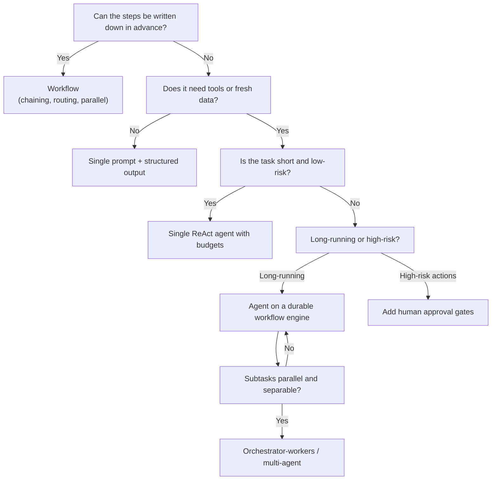

# Agent Pattern Decision Cheat-Sheet

Use this page to pick a pattern in the first minutes of an agentic interview, then justify it in the deep dive.

## Decision flow

## Problem shape to pattern

| Problem shape | Pattern | Why | Reference problem |
|---|---|---|---|
| Single Q&A over a knowledge base | RAG, single call | Grounded answer, lowest cost | [RAG Q&A](../05-agentic-problem-breakdowns/rag-qa.md) |
| Open conversation, no actions | Chat with history and safety filters | Simple, streaming | [Chatbot](../05-agentic-problem-breakdowns/chatbot.md) |
| Inputs fall into known categories | Routing then specialized handlers | Cheap models per category | [Customer Support Agent](../05-agentic-problem-breakdowns/customer-support-agent.md) |
| Fixed multi-step transformation | Prompt chaining with validation gates | Predictable, testable | Document pipelines |
| Needs actions on business systems | ReAct with tools plus approval for writes | Flexible, bounded | [Customer Support Agent](../05-agentic-problem-breakdowns/customer-support-agent.md) |
| Long tasks, hours to days | Durable workflow, async runs | Survives crashes | [Agent Runtime](../05-agentic-problem-breakdowns/agent-runtime.md) |
| Broad research with unknown subtasks | Orchestrator-workers, parallel retrieval | Breadth in parallel, small contexts | [Deep Research Agent](../05-agentic-problem-breakdowns/deep-research-agent.md) |
| Quality-critical generation | Evaluator-optimizer loop | Self-correction with a clear rubric | Code and report generation |
| Personalization over time | Long-term memory service | Context beyond one session | [Agent Memory Service](../05-agentic-problem-breakdowns/agent-memory-service.md) |
| Many tools and teams exposing capabilities | MCP gateway and registry | Shared, governed tool layer | [MCP Platform](../05-agentic-problem-breakdowns/mcp-platform.md) |

## Trade-off table

| Pattern | Latency | Cost | Predictability | Debuggability | Use autonomy when |
|---|---|---|---|---|---|
| Single call | Lowest | Lowest | High | Easy | Task is one step |
| Workflow | Low | Low | High | Easy | Path is known |
| Single agent loop | Medium | Medium | Medium | Medium | Path is unknown but bounded |
| Orchestrator-workers | High (parallel helps) | High | Medium | Hard | Subtasks emerge at runtime |
| Multi-agent debate / swarm | Highest | Highest | Low | Hardest | Rarely; prove it with evals |

## Interview heuristics

1. **Default to a workflow**; justify every step toward more autonomy with a requirement it satisfies.
2. State the **autonomy level**: read-only, write with approval, or fully autonomous, and why.
3. Name the **stop conditions** and the **cost budget** per run.
4. Say where **state** lives (run store) and how a crash resumes.
5. Say how you would **evaluate** it: golden set, tool-use accuracy, end-to-end task success, cost per task.

## Anti-patterns

- A multi-agent system where a prompt chain would do.
- An agent with 50 tools in one context and no routing.
- Unbounded loops, no per-run budget, no cancel.
- Writes with no idempotency key or approval.
- No evals, so prompt or model changes ship blind.

See [Agent Orchestration Patterns](18-agent-orchestration-patterns.md) for definitions and [Evaluation](20-evaluation-and-observability-for-llm-systems.md) for how to prove a pattern works.
