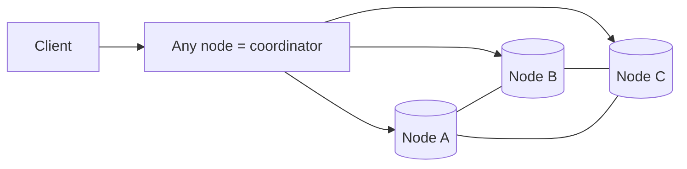

# Cassandra

Masterless, wide-column store with an LSM-tree engine. Built for very high write throughput, linear scale-out and always-on availability. Query-first modeling.

## When to use

- Write-heavy time-series, events, messages, activity logs, IoT.
- Multi-datacenter, always-available workloads with known access patterns.
- Massive scale where a sharded relational DB becomes painful.

## When to avoid

- Ad hoc queries, joins, complex aggregations.
- Strong transactions across rows (lightweight transactions exist but are slow).
- Frequent deletes or updates of the same rows (tombstones, compaction cost).
- Small datasets that fit PostgreSQL.

## Architecture



- Nodes form a **hash ring** with virtual nodes; the partition key's token decides the owners.
- Replication factor `RF` (typically 3), per datacenter via `NetworkTopologyStrategy`.
- Gossip for membership; no single point of failure.

## Write and read path

1. Write to **commit log** (durable) and **memtable** (memory), acknowledge.
2. Memtable flushes to immutable **SSTables**; background **compaction** merges them.
3. Reads merge memtable + SSTables, use Bloom filters and partition indexes to skip files.

## Tunable consistency

Per query: `ONE`, `QUORUM`, `LOCAL_QUORUM`, `ALL`. With `RF=3`, `QUORUM` writes + `QUORUM` reads (`R+W > RF`) give read-your-latest-write. `LOCAL_QUORUM` avoids cross-DC latency.

Repair: hinted handoff, read repair and scheduled anti-entropy `nodetool repair`.

## Data modeling

- **One table per query.** Duplicate data across tables instead of joining.
- Primary key = **partition key** (distribution) + **clustering columns** (sort within partition).
- Keep partitions bounded (target under ~100 MB, tens of thousands of rows); bucket by time (`(chat_id, day)`).

```sql
CREATE TABLE messages_by_chat (
  chat_id uuid,
  day date,
  msg_id timeuuid,
  sender_id uuid,
  body text,
  PRIMARY KEY ((chat_id, day), msg_id)
) WITH CLUSTERING ORDER BY (msg_id DESC);
```

## Failure modes and gotchas

- Hot or unbounded partitions; large partitions slow reads and repair.
- Tombstone buildup from deletes/TTL leads to slow reads; avoid delete-heavy queues.
- Compaction falling behind increases read latency; watch pending compactions.
- Read-before-write patterns (counters, LWT) are costly.
- Clock skew affects last-write-wins; run NTP.

## Numbers

10k-50k writes/s per node, reads typically 1-10 ms p99 on good models, scales linearly by adding nodes.

## Interview cheat-sheet

- State the query, then the partition key and clustering key that serve it.
- "RF=3, LOCAL_QUORUM, time-bucketed partitions, TTL for retention."
- Contrast: Cassandra = AP-leaning with tunable C; PostgreSQL = rich queries and transactions.
