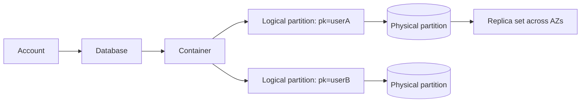

# Azure Cosmos DB

Fully managed, globally distributed, multi-model database (NoSQL API is the primary one) with guaranteed single-digit millisecond reads and writes at the 99th percentile, tunable consistency and elastic throughput.

## When to use

- Globally distributed apps needing multi-region writes and low-latency local reads.
- Key/document access with known partition key (profiles, catalogs, carts, IoT, session state).
- Elastic, spiky workloads with serverless or autoscale throughput.

## When to avoid

- Ad hoc analytics and heavy cross-partition joins (use Synapse Link/analytics or a warehouse).
- Relational transactions across many entities (use PostgreSQL/SQL).
- Cost-sensitive, large scans: RU charges grow with query cost.

## Core model

- **Container** holds JSON items with a mandatory **partition key**. Items with the same key form a **logical partition** (20 GB limit, ~10k RU/s per logical partition).
- Logical partitions are placed on **physical partitions**, split automatically as data and RU grow.
- **RU/s** (Request Units) is the throughput currency. A 1 KB point read by id and partition key costs ~1 RU; queries and writes cost more. Modes: provisioned, autoscale, serverless.

## Partition key design

- High cardinality, even distribution of storage **and** request rate; included in most queries.
- Hierarchical partition keys (e.g. `tenantId`, `userId`) beat synthetic keys for multi-tenant data.
- Cross-partition queries fan out and cost more RU; avoid on hot paths.

## Consistency levels

| Level | Guarantee | Use |
|---|---|---|
| Strong | Linearizable | Rare; single-region write, higher latency |
| Bounded staleness | Lag bounded by K versions or time T | Ordered reads, global apps |
| Session (default) | Read-your-writes in a session | Most apps |
| Consistent prefix | Ordered, never out of order | Feeds |
| Eventual | Lowest latency | Counters, non-critical |

## Multi-region

- Add regions with one click; reads served locally. **Multi-region writes** use conflict resolution (last-writer-wins on a timestamp path, or custom).
- Automatic failover with priorities; 99.999% SLA for multi-region accounts.

## Features to name

- **Change feed**: ordered log of changes per partition, for CDC, event sourcing and materialized views.
- Indexing: all properties indexed by default; tune the indexing policy to cut write RU.
- TTL on items, unique keys per partition, transactional batch within one partition key, stored procedures.

## Failure modes and gotchas

- Hot partition causes 429s even if overall RU is unused: fix the key, not just RU.
- 429 (throttled): honor `Retry-After`, SDK retries automatically.
- Large items (2 MB max) and unbounded arrays in one document: split.
- Cost: RU, storage and multi-region replication multiply.

## Interview cheat-sheet

- Say: "Partition key = X because Y; session consistency; autoscale RU; change feed to feed search/cache."
- Compare with Cassandra: Cosmos is managed with tunable consistency and RU billing; Cassandra gives full control and lower unit cost at huge scale.
