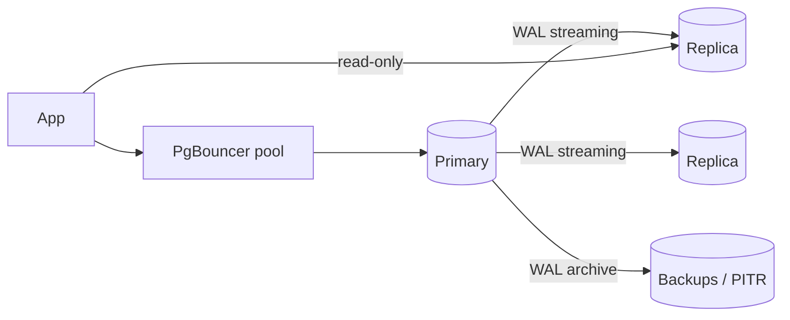

# PostgreSQL

The default relational choice: ACID transactions, rich SQL, strong indexing, extensions (PostGIS, pgvector, full-text search). A single well-tuned primary with replicas handles far more than most interviews assume.

## When to use

- Transactional data with constraints, joins and multi-row consistency (orders, bookings, accounts).
- Moderate scale: up to several TB and thousands to tens of thousands of QPS on one primary.
- Flexible querying plus JSONB, geospatial (PostGIS), vectors (pgvector), full-text.

## When to avoid (or add help)

- Write throughput beyond one node, or multi-region active-active writes: shard (Citus, app-level) or move that data to Cassandra/Cosmos DB.
- Massive full-text relevance workloads: add Elasticsearch.
- Unbounded time-series: partitioning/TimescaleDB, or a dedicated store.

## Architecture

- **MVCC**: readers do not block writers; old row versions are cleaned by `VACUUM`.
- **WAL** gives durability and drives replication and point-in-time recovery.
- Always use a **connection pooler** (PgBouncer); connections are processes and costly.

## Transactions and isolation

| Level | Notes |
|---|---|
| Read committed (default) | Each statement sees committed data |
| Repeatable read | Snapshot per transaction |
| Serializable (SSI) | Prevents anomalies; retry on serialization failure |

Concurrency tools: `SELECT ... FOR UPDATE`, `SKIP LOCKED` (job queues), advisory locks, unique constraints, optimistic `version` columns.

## Indexing

B-tree default; GIN for JSONB/arrays/full-text; GiST/SP-GiST for geo; BRIN for huge append-only tables; partial and covering (`INCLUDE`) indexes. Verify with `EXPLAIN (ANALYZE, BUFFERS)`.

## Scaling path

1. Fix queries and indexes.
2. Pooling and caching.
3. Read replicas (accept replication lag).
4. Table partitioning (time or tenant).
5. Vertical scale.
6. Shard (Citus or by tenant) or move hot workloads to specialized stores.

## Failure modes and gotchas

- Replica lag breaks read-your-writes; route recent writers to the primary.
- Long transactions block vacuum and cause bloat; watch `idle in transaction`.
- Failover needs a manager (Patroni, managed service) and fencing to avoid split brain.
- Schema migrations lock tables: use `CREATE INDEX CONCURRENTLY`, add columns with defaults carefully.
- Transaction ID wraparound if autovacuum is starved.

## Numbers

Roughly 5k-20k simple QPS and a few thousand writes/s per primary; replicas scale reads; replication lag typically under 100 ms.

## Interview cheat-sheet

- "Start with Postgres: primary plus replicas, PgBouncer, partitioned big tables."
- Use ACID for money, inventory and bookings; use `FOR UPDATE`/unique constraints to prevent double booking.
- Offload search to Elasticsearch, caching to Redis, events via outbox to Kafka.
