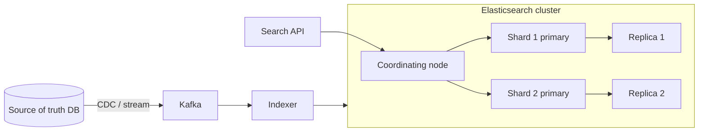

# Elasticsearch

Distributed search and analytics engine built on Lucene inverted indexes. Near-real-time, not a system of record.

## When to use

- Full-text search with relevance ranking, fuzzy matching, autocomplete.
- Faceted filtering and aggregations (e-commerce, logs, metrics).
- Geo search; vector/hybrid search in newer versions.

## When to avoid

- Primary source of truth or transactional workloads.
- Frequent small updates to the same document (updates rewrite the whole doc and segment churn).
- Strong consistency or joins as a core need.

## Architecture

- An **index** is split into **shards** (Lucene indexes); each has replicas for HA and read scale.
- Queries **scatter-gather** across shards; a coordinating node merges the top results.
- Writes go to the primary, replicate, and become searchable after a **refresh** (default ~1 s).
- Immutable **segments** are merged in the background.

## Data modeling

- Denormalize: one document per searchable item. Avoid joins/nested where possible.
- Mappings: `text` (analyzed) vs `keyword` (exact, aggregations). Define explicitly; avoid dynamic mapping surprises.
- Time-series data: one index per day/month with **ILM** (hot -> warm -> cold -> delete).

## Scaling and sizing

- Shard size target about 10-50 GB; avoid thousands of tiny shards (heap overhead).
- Number of primary shards is fixed at index creation; reindex to change.
- Separate master, data and coordinating roles at scale.

## Consistency and failure

- Eventually consistent for search (refresh interval). Reads by ID are real time.
- Treat as a **derived index**: rebuildable from the source of truth.
- Split brain is handled by master quorum; keep an odd number (3) of master-eligible nodes.
- Deep pagination is expensive; use `search_after`.

## Numbers

Indexing 10k-50k docs/s per node (document-size dependent); query latency 10-100 ms typical; keep heap at most ~30 GB.

## Interview cheat-sheet

- "Search is a secondary index fed by CDC/Kafka from the primary DB."
- Mention eventual freshness (~1 s), reindexing strategy with aliases, shard count planning and relevance versus recall.
- Autocomplete: edge n-grams or completion suggester.
