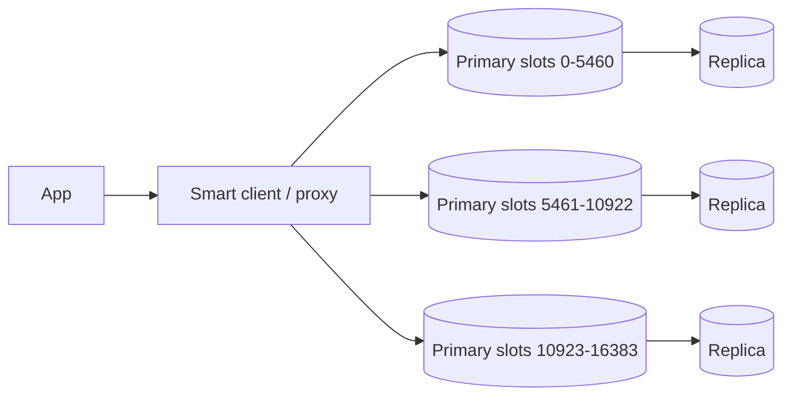

# Redis

In-memory data structure server. Single-threaded command execution gives atomic operations and sub-millisecond latency.

## When to use

| Use case | Structure |
|---|---|
| Cache, sessions | String / Hash with TTL |
| Counters, rate limiting | `INCR`, Lua script |
| Leaderboards, top-K | Sorted set (`ZADD`, `ZRANGE`) |
| Distributed lock, dedupe | `SET key val NX PX ttl` |
| Queues, streams | List, Stream (consumer groups) |
| Presence, geo lookup | Set, `GEOADD`/`GEOSEARCH` |
| Approximate counting | HyperLogLog, Bloom (module) |
| Pub/sub fan-out | Pub/Sub (fire and forget) |

## When to avoid

- As the only copy of data that must not be lost (persistence is best effort).
- Datasets far larger than affordable RAM.
- Complex queries and joins.
- Strong cross-key transactions across shards.

## Architecture

- **Redis Cluster**: 16384 hash slots spread over primaries; each primary has replicas; automatic failover.
- **Sentinel**: HA for non-clustered setups.
- Multi-key commands must hit the same slot; use hash tags (`{user42}:cart`).

## Persistence

| Mode | Trade-off |
|---|---|
| RDB snapshots | Compact, can lose minutes |
| AOF (every second / always) | Less loss, bigger files and slower |
| None | Pure cache, fastest |

## Consistency and failure

- Replication is **asynchronous**: failover can lose the last acknowledged writes. `WAIT` reduces but does not eliminate this.
- Locks via `SET NX PX` are fine for efficiency; for correctness use fencing tokens (Redlock is debated).
- Eviction when full (`allkeys-lru`, `volatile-ttl`); size `maxmemory` below host memory.
- Big keys and `KEYS *` block the single thread. Use `SCAN`, split large structures.

## Numbers

~100k+ ops/s per node, ~0.2-1 ms latency, memory overhead roughly 1.5-2x raw data.

## Interview cheat-sheet

- Default answer for **cache-aside**, **rate limiter counters**, **leaderboards**, **short-lived locks**.
- Mention TTL jitter, hot key mitigation, stampede control, cluster slots and async replication risk.
- Say what happens on a cold cache: DB must survive it.
