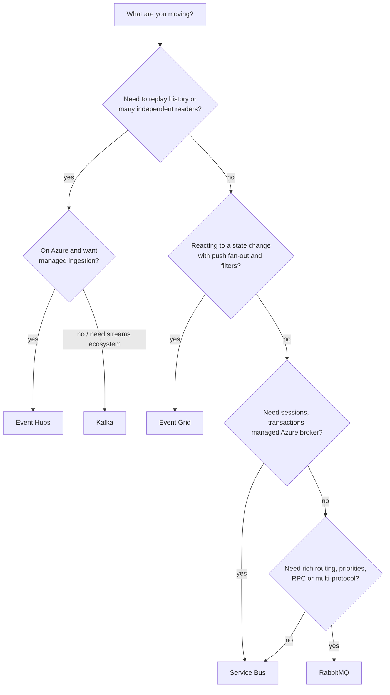

# Choosing a Messaging Technology

Pick by the **job**, not the brand: command/work queue, event stream, or event notification. Last verified: 2026-10.

## Decision tree

## Feature matrix

| | [Kafka](kafka.md) | [RabbitMQ](rabbitmq.md) | [Service Bus](service-bus.md) | [Event Hubs](event-hubs-event-grid.md) | [Event Grid](event-hubs-event-grid.md) |
|---|---|---|---|---|---|
| Model | Partitioned log | Exchange -> queues | Queues and topics | Partitioned log | Push event router |
| Message after consume | Retained | Removed on ack | Removed on complete | Retained | Not stored (retries only) |
| Replay | Yes | Streams only | No | Yes (retention, Capture) | No |
| Ordering | Per partition | Per queue (weak with many consumers) | Per session | Per partition | None |
| Routing | Topic + key | Direct, topic, fanout, headers | Subscription filters | Partition key | Event type, subject, advanced filters |
| Priority / delay | No | Priority, TTL + DLX delay | Scheduled messages, TTL | No | No |
| Dead-letter | Build your own topic | DLX | Built-in DLQ | Build your own | Dead-letter to storage |
| Transactions | Yes (Kafka-to-Kafka) | Channel transactions (slow), confirms | Yes | No | No |
| Delivery to consumer | Pull | Push (prefetch) or pull | Pull (or push via SDK) | Pull | Push (and pull in namespaces) |
| Throughput class | Highest | Medium-high | Medium | Very high | Medium |
| Latency | ms | sub-ms to ms | ms to tens of ms | ms | Tens of ms to seconds |
| Operations | Cluster or managed | Cluster or managed | Fully managed | Fully managed | Fully managed |

## Special features at a glance

| Technology | Remember it for |
|---|---|
| Kafka | Log replay, consumer groups, compaction, stream processing, exactly-once within Kafka |
| RabbitMQ | Flexible exchanges and routing, priorities, TTL and DLX retry, RPC, MQTT/STOMP, streams |
| Service Bus | Sessions (FIFO per key), transactions, duplicate detection, DLQ, scheduled delivery, filters |
| Event Hubs | Azure-managed ingestion at scale, Capture to storage, Kafka endpoint, Schema Registry |
| Event Grid | Serverless reactive events, Azure system events, filters, webhook/Function handlers |

## Quick picks

| Requirement | Pick |
|---|---|
| Background jobs with retries and a DLQ, on Azure | Service Bus |
| Per-conversation FIFO | Service Bus sessions (or Kafka key if replay needed) |
| Task queue with priorities or complex routing | RabbitMQ |
| Event sourcing, CDC, analytics, reprocessing | Kafka or Event Hubs |
| Telemetry or trace ingestion on Azure | Event Hubs |
| Blob created triggers ingestion; run completed notifies others | Event Grid |
| IoT devices over MQTT | Event Grid namespaces MQTT, or RabbitMQ MQTT |
| Existing Kafka clients, want managed Azure | Event Hubs Kafka endpoint |

## Common combinations

- Event Hubs (telemetry in) -> stream processor -> Service Bus (commands out).
- Event Grid (state change) -> Service Bus queue (reliable processing with retries and DLQ).
- Kafka as the system of record for events, RabbitMQ or Service Bus for work queues derived from it.

## Interview cheat-sheet

- Start from the access pattern: "consumed once and deleted" -> queue; "many readers and replay" -> log; "notify on change" -> event router.
- State the guarantee: at-least-once everywhere, so idempotent consumers; ordering only per partition or session.
- Always mention DLQ and lag or queue-depth alerts.
- Concept background: [Message Queues and Streaming](../../02-core-concepts/03-performance-and-reliability/message-queues-and-streaming.md).
