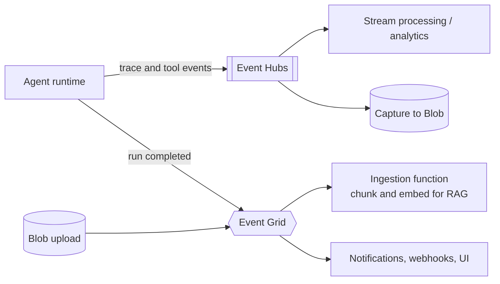

# Azure Event Hubs and Event Grid

Two different "event" services. **Event Hubs** ingests high-volume event streams into a partitioned log (pull, replay). **Event Grid** routes discrete events to handlers (push, filters, no replay). Last verified: 2026-10.

## Which one

| | Event Hubs | Event Grid |
|---|---|---|
| Model | Partitioned log, consumers pull | Pub/sub router, pushes to handlers (pull delivery also available in namespaces) |
| Typical payload | Telemetry, logs, clickstream, CDC | "Something happened": blob created, run completed, resource changed |
| Volume | Very high, millions of events/s class at scale | Lower, per-event routing |
| Replay | Yes, within retention (and archive via Capture) | No; retries, then dead-letter |
| Ordering | Per partition | Not guaranteed |
| Consumers | Consumer groups with checkpoints | Subscriptions with filters |
| Equivalent | [Kafka](kafka.md) | Event bus / notification service |

## Choose it when / avoid it when

| Service | Choose it when | Avoid it when |
|---|---|---|
| Event Hubs | Ingest telemetry or logs, stream processing, need Kafka compatibility on a managed Azure service, multiple independent readers | Per-message ack, retries, sessions or DLQ (use [Service Bus](service-bus.md)); complex routing ([RabbitMQ](rabbitmq.md)) |
| Event Grid | React to Azure or custom state changes, serverless fan-out to Functions, webhooks and queues | You need ordering, replay or a durable log; bulk streaming |

## Event Hubs special features

| Feature | What it gives you |
|---|---|
| Partitions and **consumer groups** | Parallel reads; each group tracks its own position |
| Checkpointing (event processor) | Resume from last processed offset after restart |
| **Capture** | Automatic archive to Blob Storage or Data Lake in Avro/Parquet formats |
| **Kafka protocol endpoint** | Existing Kafka clients and tools connect with config changes |
| Schema Registry | Versioned Avro/JSON schemas with compatibility checks |
| Retention by tier | Time-based retention (1 day on Basic, up to 7 on Standard, longer on Premium/Dedicated); archive with Capture for more |
| Throughput scaling | Throughput/processing units or capacity units by tier; autoscale on some tiers |
| Geo-disaster recovery and replication | Namespace pairing or geo-replication on higher tiers |

Event Hubs has no per-message ack, DLQ or delayed delivery; handle poison events in your consumer and park them elsewhere.

## Event Grid special features

| Feature | What it gives you |
|---|---|
| Topics (system, custom, partner) and subscriptions | Source events from Azure services (Blob, Resource Manager) or your own apps |
| **Filters** (event type, subject, advanced) | Each handler gets only what it needs |
| Handlers | Webhooks, Functions, Service Bus, Event Hubs, Storage queues |
| CloudEvents v1.0 and Event Grid schema | Standard envelope |
| Retry with backoff, **dead-lettering** to storage | At-least-once delivery with a parking lot |
| Namespaces: MQTT broker and pull delivery | IoT pub/sub and consumer-paced delivery |

## Agent patterns

- Event Hubs for high-volume traces, token usage and audit events feeding analytics (see [evaluation and observability](../../02-core-concepts/04-agentic/evaluation-and-observability-for-llm-systems.md)).
- Event Grid for blob upload to RAG ingestion and "run completed" broadcast.
- Combine: Event Grid -> Service Bus queue when you need reliable processing with retries and DLQ after a notification.

## Failure modes

- Event Hubs: hot partition from a skewed key; consumer lag; losing checkpoints causes reprocessing, so keep handlers idempotent.
- Event Hubs: retention shorter than a consumer outage drops history; archive with Capture.
- Event Grid is not a log: handlers must be idempotent and may see duplicates and reordering.
- Event Grid: a slow or failing webhook is retried then dead-lettered; monitor the dead-letter location.

## Interview cheat-sheet

- Say: "Telemetry goes to Event Hubs with Capture for replay and analytics; discrete state changes go through Event Grid to a Service Bus queue for reliable processing."
- Compare with other options in [Choosing a Messaging Technology](choosing-a-messaging-technology.md).
