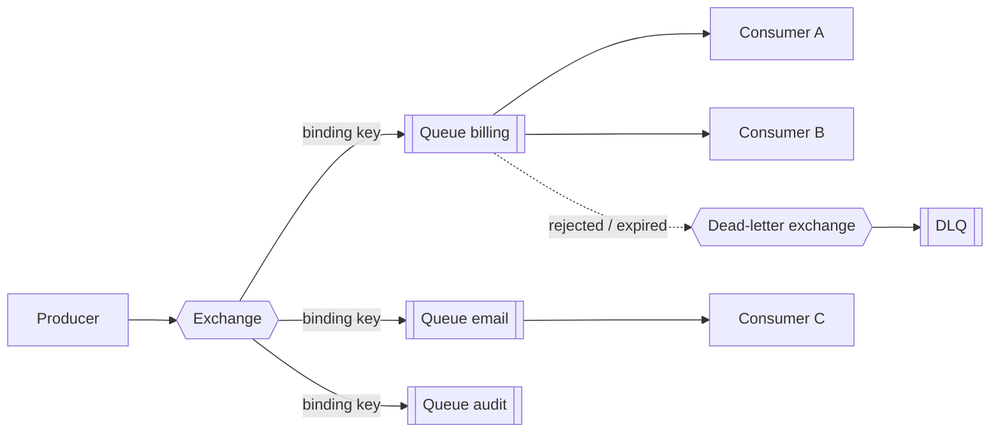

# RabbitMQ

Smart broker with flexible routing: producers publish to **exchanges**, which route to **queues** via bindings. Classic message broker for work queues, RPC and per-message control. Last verified: 2026-10.

## Choose it when / avoid it when

| Choose it when | Avoid it when |
|---|---|
| Work queues with per-message ack, retry, priority and delay | You need long retention and replay by many independent consumers ([Kafka](kafka.md), [Event Hubs](event-hubs-event-grid.md)) |
| Complex routing (by key, pattern, headers, fan-out) | Throughput of hundreds of MB/s or millions of msgs/s on one logical stream |
| Request/reply (RPC) between services | You want a fully managed Azure-native broker with sessions and transactions ([Service Bus](service-bus.md)) |
| Multi-protocol clients (AMQP 0-9-1, AMQP 1.0, MQTT, STOMP) | Strict global ordering across consumers |
| Self-hosted or cloud-neutral deployments | You cannot operate a cluster and no managed offering is available |

## Architecture

- Producers never write to a queue directly; the exchange decides where a message goes.
- Consumers on one queue compete for messages (work distribution); separate queues give each subscriber its own copy.
- A message is removed from the queue once acknowledged (no replay on classic and quorum queues).

## Special features

| Feature | What it gives you |
|---|---|
| Exchange types: direct, topic, fanout, headers | Route by exact key, wildcard pattern (`orders.*.eu`), broadcast, or header match |
| Per-message **priority** (classic and quorum queues) | Urgent jobs overtake normal ones |
| Per-queue and per-message **TTL**, dead-letter exchanges | Delayed retry via a TTL "wait" queue that dead-letters back; poison parking |
| Publisher confirms and consumer acks | At-least-once end to end; `prefetch` limits in-flight messages per consumer |
| **Quorum queues** (Raft) | Replicated, durable queues; recommended default for data safety |
| **Streams** | Append-only log with offsets and replay, Kafka-like, for fan-out and history |
| Request/reply (`reply_to`, `correlation_id`) | RPC over messaging |
| Federation and shovel | Move messages across clusters and regions |
| Multi-protocol plugins | AMQP 1.0, MQTT (IoT), STOMP, WebSockets |
| Management UI and per-queue metrics | Easy inspection of depth, rates and consumers |

## Delivery guarantees

| Setting | Effect |
|---|---|
| Quorum queue + publisher confirms + durable messages | No loss on a single node failure |
| Manual consumer ack after processing | At-least-once consumption |
| Dedup via message ID in the consumer | Idempotent handling of redelivery |
| Single active consumer | Ordering for one queue with failover |

## Scaling

- A queue is served by one node (its leader); scale by spreading **many queues** across nodes, or by sharding with consistent-hash exchange.
- More consumers on a queue increase parallelism but weaken ordering.
- Keep queues short: long backlogs hurt memory and recovery; use streams for large retained data.
- Set `prefetch` (for example 10-50) to balance throughput and fairness; use 1 for slow, long jobs.

## Failure modes

- Unbounded queue growth causes memory alarms and flow control that blocks publishers; set max length and overflow policy, alert on depth.
- Redelivery loops on poison messages: cap delivery count (quorum queues) and route to a DLX.
- Network partitions on classic mirrored queues lose data; prefer quorum queues.
- Unacked messages from a slow consumer starve others: tune `prefetch` and consumer timeout.

## Numbers

Roughly tens of thousands of msgs/s per node for small persistent messages, higher for transient ones; latency in the low ms. Depends heavily on message size, confirms and queue type, so treat as an order of magnitude and benchmark.

## Interview cheat-sheet

- Say: "Topic exchange routes by event type to per-service queues; quorum queues, publisher confirms, manual ack, idempotent consumers, DLX with a TTL retry queue."
- Pick RabbitMQ for routing flexibility and task queues; pick Kafka for replay and scale; compare in [Choosing a Messaging Technology](choosing-a-messaging-technology.md).
- Related: [Message Queues and Streaming](../../02-core-concepts/03-performance-and-reliability/message-queues-and-streaming.md).
