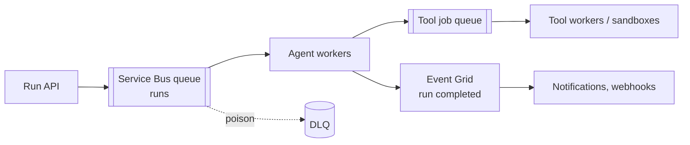

# Azure Service Bus

Transactional enterprise message broker for commands and work queues. Queues and topics with per-message ack, sessions, dead-lettering and transactions. In agent systems it decouples ingestion from tool work. Last verified: 2026-10.

## Choose it when / avoid it when

| Choose it when | Avoid it when |
|---|---|
| Reliable work queue with retries, DLQ and per-message settlement | You need replay or many independent readers of history (use [Kafka](kafka.md) or [Event Hubs](event-hubs-event-grid.md)) |
| FIFO per conversation or run (sessions) | You need reactive fan-out of state changes with filters and webhooks (use Event Grid) |
| Atomic "complete + send" across entities | You need exchange-style routing or message priorities ([RabbitMQ](rabbitmq.md)) |
| Managed service on Azure, no broker to operate | Very high throughput streams (hundreds of MB/s) |
| Delayed delivery, TTL, duplicate detection out of the box | Cloud-neutral or on-prem requirement without AMQP 1.0 clients |

## Special features

| Feature | What it gives you |
|---|---|
| Queues and topics/subscriptions | Task queues, or fan-out where each subscription gets its own copy |
| Subscription filters and actions | SQL or correlation filters route a topic copy per consumer |
| Peek-lock | Process, then complete; abandon or let the lock expire to retry (lock duration max 5 min, renew for long work) |
| Max delivery count and **dead-letter queue** | Poison messages go to the DLQ after N attempts (default 10); alert and replay |
| Duplicate detection | Dedup by `MessageId` within a time window |
| **Sessions** | FIFO per session ID with an exclusive consumer, plus session state |
| Scheduled messages and TTL | Delayed retries, timeouts |
| Transactions | Complete + send atomically (up to 100 messages) |
| Auto-forwarding | Chain queues and subscriptions |
| Geo-replication (Premium) | Replicate data and metadata to a secondary region |

Limits: message 256 KB on Standard; Premium up to 100 MB (AMQP, default 1 MB); entity up to 80 GB; Standard is credit-throttled, Premium scales by messaging units. Store large prompts and documents in blob storage and send a reference.

## Agent patterns

- Idempotent consumers: key on `runId + stepId`; combine duplicate detection with idempotency keys downstream.
- Backpressure: queue depth and oldest-message-age drive autoscaling (for example KEDA on Container Apps).
- Use a session per conversation (`conversationId` or `runId`) when order matters; otherwise competing consumers for throughput.
- For multi-step, long runs prefer a [durable orchestration](../04-agentic-platform/durable-orchestration.md) and use queues at the edges.

## Failure modes

- Lock expiry during slow model calls causes duplicate processing: renew locks or ack early and track state elsewhere.
- Session hot spot: one chatty session blocks its queue lane.
- DLQ ignored: alert on DLQ depth.

## Interview cheat-sheet

- Say: "Runs enter a Service Bus queue with a session per conversation; workers are idempotent; poison goes to the DLQ with alerts; large payloads live in blob storage."
- Compare with other options in [Choosing a Messaging Technology](choosing-a-messaging-technology.md).
- Related: [Message Queues and Streaming](../../02-core-concepts/03-performance-and-reliability/message-queues-and-streaming.md), [Rate Limiting, Idempotency and Retries](../../02-core-concepts/03-performance-and-reliability/rate-limiting-idempotency-retries.md).
