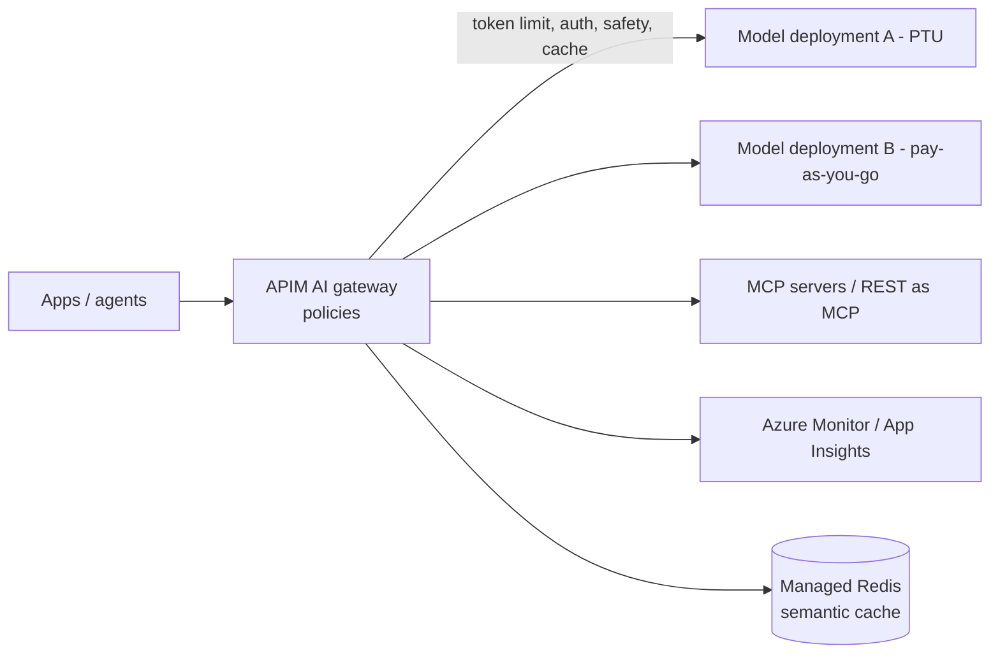

# Azure API Management as an AI Gateway

Central control point in front of model deployments, MCP servers and agents: auth, quotas, routing, caching, safety and telemetry. Last verified: 2026-10.

## When to use

- Several apps or tenants share model quota (TPM) and need per-consumer limits and chargeback.
- Multiple model deployments or regions need load balancing and failover.
- You need one governed entry for LLM APIs, MCP servers and agent (A2A) APIs.

## When to avoid

- A single app with one deployment (set limits on the deployment directly).
- Ultra-low-latency paths where an extra hop is unacceptable (it is usually a few ms).

## Core model

## Capabilities

| Need | Feature |
|---|---|
| Per-consumer budgets | `llm-token-limit`: tokens per minute or hourly-to-yearly quota, keyed by subscription, IP or any expression; can pre-estimate prompt tokens to reject early |
| Chargeback and metrics | `llm-emit-token-metric` with custom dimensions to Azure Monitor; log prompts and completions to Application Insights |
| Cost and latency | `llm-semantic-cache-lookup` / `store` backed by Azure Managed Redis (or a RediSearch-compatible cache) plus an embeddings call |
| Resilience | Backend pool load balancer (round-robin, weighted, priority, session-aware) and circuit breaker that honors `Retry-After`. Typical: PTU first, pay-as-you-go as spillover |
| Safety | `llm-content-safety` policy to moderate prompts |
| Auth | Managed identity to backends (no keys), OAuth through credential manager, Entra for callers |
| MCP and A2A | Expose a REST API as an MCP server, govern an existing MCP server, import A2A agent APIs; register in API Center for discovery |

## Design notes

- Semantic cache keys must include tenant and permissions; never share answers across users with different access.
- Put token limits on `counter-key = tenant or app` so one noisy tenant cannot drain shared TPM.
- Streaming responses work, but some features (full-response caching, content checks on output) are limited for streams. Test them.
- Deploy gateway regions next to backends.

## Failure modes

- Gateway becomes a single point of failure: multi-region, multiple units.
- Cache poisoning or stale answers: TTL, tenant partitioning, similarity threshold.
- Misconfigured limits cause surprise 429s: alert on 429 rate per consumer.

## Interview cheat-sheet

- Say: "APIM AI gateway: per-tenant token limits and metrics, PTU-first load balancing with circuit breaker spillover, semantic cache per tenant, content safety, and MCP servers registered and governed in one place."
- Related: [LLM Fundamentals](../../02-core-concepts/04-agentic/llm-fundamentals.md), [Redis](../02-caching-and-search/redis.md).
