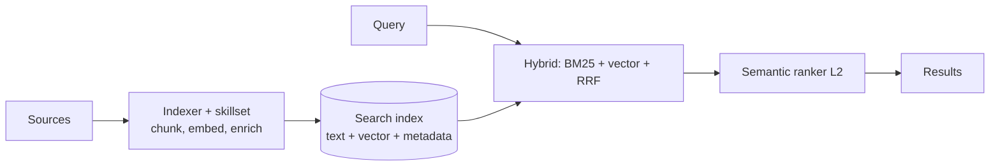

# Azure AI Search

Managed search service: full-text, vector, hybrid, semantic reranking, indexers and agentic retrieval. The usual RAG backbone on Azure. Last verified: 2026-10.

## When to use

- RAG over enterprise content needing hybrid search, reranking and filters.
- Built-in ingestion (indexers for Blob, SharePoint, SQL, Cosmos DB) and enrichment.
- Complex questions where multi-query retrieval helps (agentic retrieval).

## When to avoid

- System of record or transactions (use a database).
- Tiny corpora (a vector column in PostgreSQL or Cosmos DB may be enough, see [Vector Databases](vector-databases.md)).
- Heavy log analytics (use [Elasticsearch](elasticsearch.md) or a log store).

## Core model

| Concept | Notes |
|---|---|
| Index | Fields, vector fields (up to 4096 dims), filters, scoring profiles |
| Capacity | Search units = replicas x partitions. Replicas for QPS and HA, partitions for storage and indexing |
| Tiers | Basic, S1-S3, S3 HD, L1-L2; Serverless Developer is preview |
| Vector memory | Vector index lives in memory; per-partition quota (for example S1 ~35 GB, S3 ~300 GB on newer services). Use quantization and smaller dims to fit |
| SLA | Needs 2+ replicas for reads, 3+ for read/write |
| Semantic ranker | Reranks top results; has a per-unit concurrency queue and can throttle |

## Agentic retrieval

A **knowledge base** with one or more **knowledge sources** (indexed or remote). An LLM plans subqueries from the question and chat history, subqueries run in parallel (keyword, vector or hybrid) with semantic reranking, and results merge with citations and an activity log. Reasoning effort (`minimal` skips LLM planning, `low`, `medium`) trades latency and cost for quality. Billing is retrieval tokens plus model tokens. It backs Foundry IQ and can be queried by a retrieve call or an MCP endpoint. LLM planning is preview; check the API version.

## Security

- Document-level security: filter by ACL group IDs stored on documents, using the caller's identity. See [RAG](../02-core-concepts/15-embeddings-vector-search-rag.md).
- Entra auth and RBAC, private endpoints, customer-managed keys.

## Operations and failure modes

- Indexer limits: minimum 5-minute schedule, runs capped (about 2 h), 16 MB request payload, 1,000 docs per batch.
- Reindexing for a new embedding model needs a second index and an alias swap.
- Throttling (429/503): backoff, add replicas.
- Vector quota exhaustion fails indexing: scale partitions or compress vectors.

## Interview cheat-sheet

- Say: "AI Search with hybrid query, semantic reranker, ACL filter, indexers off the source, blue/green index with an alias for re-embedding, replicas for QPS."
