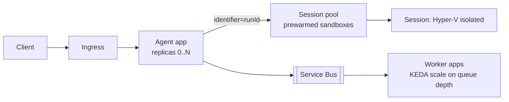

# Azure Container Apps (Agent Hosting and Sandboxed Execution)

Serverless container platform with autoscaling (including scale to zero) and **dynamic sessions** for isolated code and tool execution. Last verified: 2026-10.

## When to use

- Host agent backends, MCP servers and tool workers as containers with HTTP/gRPC ingress and event-driven scaling (KEDA).
- Run untrusted or model-generated code in strongly isolated, short-lived sandboxes.
- Durable Task SDK workers (see [Durable Orchestration](durable-orchestration.md)).

## When to avoid

- Need full Kubernetes control, custom operators, GPUs at scale: use AKS.
- Pure managed agent hosting is enough: use [Foundry](foundry.md) hosted agents.

## Core model

## Autoscaling

- HTTP concurrency, CPU/memory, or KEDA scalers (Service Bus queue depth, Event Hubs lag, cron).
- Scale to zero saves cost but adds cold start; set a minimum replica count for latency-sensitive agent APIs.
- Streaming (SSE) holds connections: scale on concurrent requests and set generous timeouts.

## Dynamic sessions (sandbox)

| Aspect | Detail |
|---|---|
| Session pool | Prewarmed, ready sessions, so allocation takes milliseconds |
| Isolation | Hyper-V isolation, optional network controls, sessions isolated from each other and the host |
| Pool types | **Code interpreter** (built-in runtimes, REST API, no image) or **custom container** (your image, any TCP protocol) |
| Routing | Calls include an `identifier`; the pool routes to the existing session or allocates one. Use `identifier = runId` or `userId` to keep state across calls |
| Lifecycle | Destroyed after a configurable cooldown without activity; list and inspect sessions via API |

Sandbox rules (same threat model as [LeetCode](../04-problem-breakdowns/leetcode.md)): no ambient credentials, restrict egress, cap CPU/memory/time, treat all output as untrusted, never mount secrets into the session.

## Identity and networking

- Managed identity to Foundry, Cosmos DB, Key Vault; no keys in config.
- Internal environments with VNet integration and private endpoints; Entra auth on ingress for MCP servers.

## Failure modes

- Cold start spikes after scale to zero: min replicas.
- Session state loss on cooldown: persist artifacts to blob storage, not the sandbox.
- Pool exhaustion under bursts: size the pool, queue requests, rate-limit per tenant.
- Long-lived streams killed by idle timeouts: send keep-alives.

## Interview cheat-sheet

- Say: "Agent API and MCP servers run on Container Apps scaled by queue depth and concurrency; code tools run in a dynamic-session sandbox keyed by runId with egress denied; artifacts go to blob storage."
- Related: [Tool Use and MCP](../02-core-concepts/17-tool-use-mcp-and-agent-protocols.md), [Security](../02-core-concepts/21-agent-security-safety-guardrails.md).
