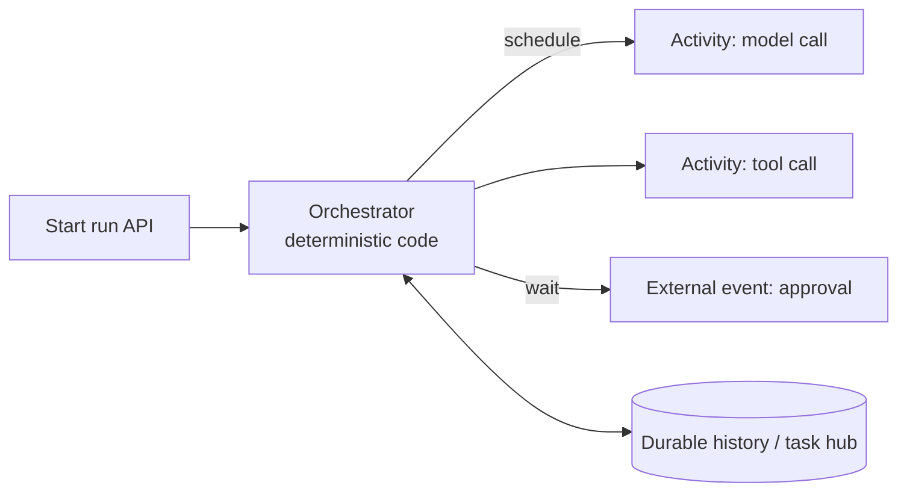

# Durable Orchestration (Durable Functions, Durable Task, Temporal)

Durable execution persists workflow progress so long-running, multi-step processes survive crashes, deploys and waits. It is the natural runtime for agent runs. Last verified: 2026-10.

## When to use

- Agent runs lasting minutes to days, with retries, timers and human approvals.
- Sagas and compensation across unreliable services.
- Fan-out/fan-in (parallel sub-agents) with a guaranteed join.

## When to avoid

- Short request/response calls (a plain function is simpler).
- Very high-throughput, tiny tasks (a queue and workers are cheaper).

## Core model

- **Orchestrator** code is replayed from an event-sourced history, so it must be **deterministic**: no wall-clock, random or direct I/O. Use the framework's time and GUID APIs.
- **Activities** do the I/O (model calls, tools) with retry policies, timeouts and idempotency keys. Their results are recorded and reused on replay, so a model call is not repeated after a crash.
- **External events** and **timers** implement human-in-the-loop and deadlines without holding a thread.
- **Entities** hold small keyed state (per-user counters, locks).

## Azure options

| Option | Notes |
|---|---|
| **Durable Functions** | Orchestrators and activities in Azure Functions (C#, JS/TS, Python, PowerShell, Java) |
| **Durable Task SDKs** | Same engine on any compute: Container Apps, AKS, App Service, VMs |
| **Durable Task Scheduler** | Recommended managed backend: gRPC push model, no storage account, task hubs, dashboard, autopurge; Dedicated and Consumption SKUs |

Limits to name: 1 MB payload for orchestrator/activity inputs and outputs, external events, custom status and entity state (use large-payload support or store blobs and pass references); 3.9 MB per work item completion; instance ID up to 100 chars; task hubs on one scheduler share resources.

## Alternatives

| Engine | Notes |
|---|---|
| **Temporal** | Workflows, activities, signals, queries; strong replay model; self-host or cloud; multi-language SDKs |
| Agent framework workflows with checkpoints | Graph workflows with state and human-in-the-loop, see [Agent Frameworks](agent-frameworks.md); pair with a durable backend for long runs |
| Queue + state table (hand-rolled) | Fine for simple flows; you own retries, timers and replay |

## Patterns for agents

- One orchestration per **run**; instance ID = `runId`.
- Activity per model call and per tool call, each with timeout and retry/backoff.
- Parallel tool or sub-agent calls with fan-out/fan-in.
- `WaitForExternalEvent` with timeout for approvals; default to deny on timeout.
- Continue-as-new (or a new run) for very long loops to keep history small.
- Keep prompts and large outputs in blob/DB; pass IDs.

## Failure modes

- Non-deterministic orchestrator code causes replay errors: review code constraints.
- History growth: continue-as-new, purge completed runs.
- Poison activity: retry limits, then dead-letter or compensate.
- Versioning running workflows: route new runs to the new version, drain old ones.

## Interview cheat-sheet

- Say: "Run = durable orchestration; model and tool calls are activities with idempotency keys; approvals are external events with timeouts; a crash resumes from history, not from the beginning."
- Related: [Agent Orchestration Patterns](../02-core-concepts/18-agent-orchestration-patterns.md), [Service Bus and Event Grid](service-bus-event-grid.md).
