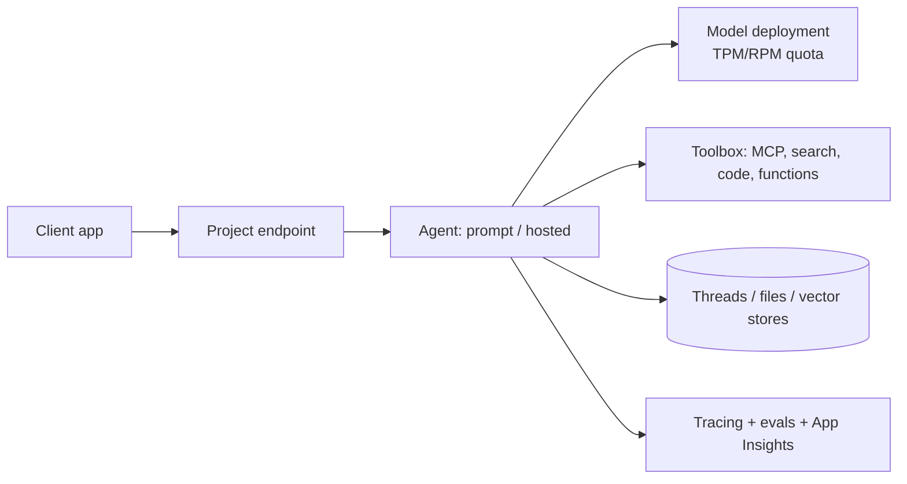

# Microsoft Foundry (Agent Service and Models)

Managed Azure platform to deploy models and build, host, evaluate and govern agents. Last verified: 2026-10.

## When to use

- You want a managed agent runtime (conversations, tools, scaling, identity) instead of building the loop yourself.
- Enterprise needs: Entra identity, RBAC, private networking, content safety, tracing and evals in one place.
- Model choice and swap without code changes (OpenAI models and others from the catalog).

## When to avoid

- Fully custom control plane or non-Azure portability is the top requirement (use a framework on your own compute, see [Agent Frameworks](agent-frameworks.md)).
- Very hot, cost-sensitive paths where a direct model call plus your own orchestration is simpler.

## Core model

| Concept | Notes |
|---|---|
| Prompt agent | Config only: instructions, model, tools. Foundry runs it |
| Hosted agent | Your code (Agent Framework, LangGraph, others) as a container or zip; managed endpoint, scaling, dedicated Entra identity, session state |
| Responses API | "Ephemeral agent": definition lives in your code; still uses Foundry models, tools, governance |
| Toolbox | Curated tools exposed behind one managed MCP endpoint with central auth, governance and versioning |
| Tools | Web search, file search, code interpreter, MCP, OpenAPI, functions, AI Search, A2A, SharePoint, Fabric, memory |
| Storage | Basic: Microsoft-managed. Standard: your Cosmos DB (threads), AI Search (vectors), Blob (files) |

## Limits to name (verify before relying)

- 128 tools per agent, 1,000 versions per agent, 100k messages per thread, 10k files per agent/thread.
- Model calls are limited by deployment TPM/RPM; hosted agent sessions have per-subscription regional quotas (1,000-2,000 concurrent).
- 429s: backoff with jitter; `session_quota_exceeded` means stop idle sessions or raise quota.

## Security and governance

- Agent identity (Entra), RBAC, on-behalf-of (OBO) passthrough, managed identity auth for MCP tools.
- Guardrails and content filters, including cross-prompt injection (XPIA) mitigation.
- Private networking (BYO VNet), publish to Teams, Microsoft 365 Copilot and the Entra Agent Registry.
- AI gateway integration (APIM) for quotas and governance, see [APIM AI Gateway](azure-api-management-ai-gateway.md).

## Failure modes

- Region or model without a needed tool: check the tool-by-region matrix first.
- Thread growth: rotate threads, summarize.
- Quota exhaustion: multiple deployments or regions, provisioned throughput, gateway fallback.

## Interview cheat-sheet

- Say: "Prompt agent for simple cases, hosted agent when I need custom orchestration; Standard setup so threads live in my Cosmos DB and vectors in AI Search; tools through a toolbox; evals and tracing gate releases."
- Related: [Evaluation](../02-core-concepts/20-evaluation-and-observability-for-llm-systems.md), [Security](../02-core-concepts/21-agent-security-safety-guardrails.md).
