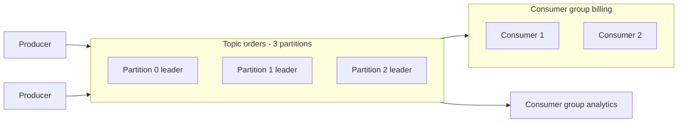

# Kafka

Distributed, partitioned, replicated commit log. High-throughput durable messaging and event streaming with replay.

## When to use

- Decouple services and buffer bursts.
- Event streaming, CDC pipelines, audit logs, event sourcing.
- Multiple independent consumers of the same data; reprocessing from history.
- Stream processing (Kafka Streams, Flink).

## When to avoid

- Simple task queues with per-message ack/priority/delay (a queue like SQS/RabbitMQ is simpler).
- Request/response with tight latency.
- Very small scale where operating a cluster is overkill (use a managed service).

## Architecture

- Topic -> **partitions**; each partition is an append-only ordered log with a leader and follower replicas (ISR).
- **Key** decides the partition (`hash(key) % partitions`). Ordering exists only inside a partition.
- A consumer group assigns each partition to one consumer; offsets track progress.
- Retention by time/size, or **log compaction** (keep latest value per key).

## Delivery guarantees

| Setting | Effect |
|---|---|
| `acks=all` + `min.insync.replicas=2`, replication factor 3 | No loss on single broker failure |
| Idempotent producer | No duplicates from producer retries |
| Transactions | Atomic writes across partitions, exactly-once in Kafka-to-Kafka flows |
| Commit offset after processing | At-least-once consumption |

## Scaling

- Throughput scales with partitions and brokers. Consumer parallelism is capped by partition count.
- Plan partitions up front (increasing breaks key-to-partition mapping for ordering).
- Hot key causes hot partition; add a salt if ordering per key is not required.

## Failure modes

- Consumer lag grows: scale consumers (up to partition count), fix slow handlers, alert on lag.
- Rebalance storms: use cooperative rebalancing, static membership.
- Poison message: retry topic and dead-letter topic.
- Unclean leader election can lose data; keep it disabled for critical topics.

## Numbers

Per broker: hundreds of MB/s, 100k+ msgs/s; end-to-end latency of a few ms to tens of ms; typical topic partitions 6-100s.

## Interview cheat-sheet

- Pick the partition key from the ordering requirement (`chat_id`, `order_id`, `user_id`).
- Say: replication factor 3, `acks=all`, idempotent consumers, DLQ, lag monitoring.
- Use the outbox pattern for DB-to-Kafka consistency.
