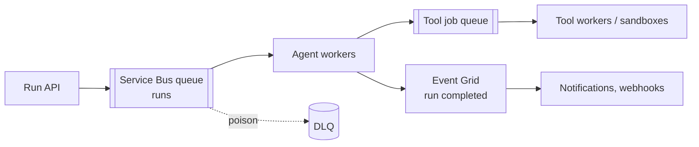

# Azure Service Bus and Event Grid

Service Bus is a transactional message broker for commands and work queues. Event Grid routes discrete events (push) to many handlers. In agent systems they decouple ingestion, tool work and notifications. Last verified: 2026-10.

## When to use

| Need | Pick |
|---|---|
| Reliable work queue with retries, DLQ, ordering per key | **Service Bus** queue or topic |
| Per-conversation or per-run ordering | Service Bus **sessions** (session ID = `conversationId` or `runId`) |
| React to state changes (blob created, resource event, custom event) with fan-out | **Event Grid** |
| High-volume telemetry or log streams, replay | Event Hubs or [Kafka](kafka.md) |

## Service Bus essentials

| Feature | Use for agents |
|---|---|
| Queues and topics/subscriptions | Task queues for tool jobs; topics for fan-out to several consumers |
| Peek-lock | Process, then complete; abandon or let the lock expire to retry (lock duration max 5 min, renew for long work) |
| Max delivery count and **dead-letter queue** | Poison messages go to DLQ after N attempts (default 10); alert and replay |
| Duplicate detection | Dedup by `MessageId` within a window |
| **Sessions** | FIFO per session ID with exclusive consumer, plus session state (up to 1M session states per entity) |
| Scheduled messages and TTL | Delayed retries, timeouts |
| Transactions | Complete + send atomically (up to 100 messages) |

Limits: message 256 KB on Basic/Standard; Premium up to 100 MB (AMQP, default 1 MB); entity up to 80 GB; Standard is credit-throttled (~1,000 ops/s class), Premium scales by messaging units. Store large prompts and documents in blob storage and send a reference.

## Event Grid essentials

- Topics, subscriptions and filters; push to webhooks, Functions, Service Bus, Event Hubs.
- At-least-once delivery with retries and dead-lettering to storage.
- Typical flows: blob upload triggers document ingestion for RAG; agent run completion event notifies a UI or another system.

## Agent patterns

- Idempotent consumers: key on `runId + stepId`; combine duplicate detection with idempotency keys downstream.
- Backpressure: queue depth and oldest-message-age drive autoscaling (for example KEDA on Container Apps).
- Use a session per conversation when order matters; otherwise competing consumers for throughput.
- For multi-step, long runs prefer a [durable orchestration](durable-orchestration.md) and use queues at the edges.

## Failure modes

- Lock expiry during slow model calls causes duplicate processing: renew locks or ack early and track state elsewhere.
- Session hot spot: one chatty session blocks its queue lane.
- DLQ ignored: alert on DLQ depth.
- Event Grid is not a log: handlers must be idempotent and may see duplicates and reordering.

## Interview cheat-sheet

- Say: "Runs enter a Service Bus queue with a session per conversation; workers are idempotent; poison goes to the DLQ with alerts; Event Grid broadcasts completion; large payloads live in blob storage."
- Related: [Message Queues and Streaming](../02-core-concepts/11-message-queues-and-streaming.md), [Rate Limiting, Idempotency and Retries](../02-core-concepts/12-rate-limiting-idempotency-retries.md).
