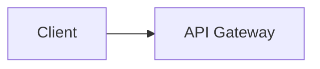

# Design: Problem Name

One-sentence description and the core challenge.

## 1. Requirements

**Functional**
1. ...

**Non-functional**
- ... (quantified)

**Out of scope**
- ...

## 2. Core Entities

- ...

## 3. API

```text
METHOD /v1/resource
```

## 4. Data Flow (optional)

1. ...

## 5. High-Level Design



Relevant schema fields and what each request changes.

## 6. Deep Dives

### 6.1 NFR or bottleneck
Problem, options, trade-off, choice, failure mode.

## 7. Staff-Level Notes

- **Trade-offs**
- **Failure modes**
- **Observability**
- **Evolution at 10x**
