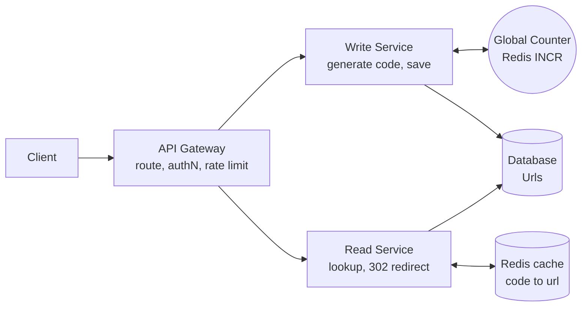

# Design Bitly (URL Shortener)

Create short links that redirect to long URLs. The challenge: generating unique codes at scale and serving a read-heavy redirect path with very low latency.

## 1. Requirements

**Functional**
1. Users create a short URL from a long URL, optionally with a custom alias and expiration.
2. Users opening a short URL are redirected to the original URL.

**Out of scope**: analytics dashboards, user accounts and management UI.

**Non-functional**
- Redirect latency under 100 ms p99.
- Highly available for redirects; availability over consistency (a link created a second ago may take a moment to be visible globally).
- Uniqueness: no two long URLs share a code.
- Scale: ~100M DAU, ~1B stored URLs, read:write about 100:1.

**Estimation that drives the design**
- 1B URLs x ~500 B = ~500 GB. Fits on one database node, so sharding is for throughput and availability, not size.
- ~100M redirects/day is ~1k RPS average and ~10k RPS peak. A cache plus a few DB replicas is enough.
- 7 base62 characters give 62^7 = ~3.5T codes: ample.

## 2. Core Entities

- **Url**: short code, original URL, creation time, expiration time, creator
- **User**

## 3. API

```
POST /v1/urls
body: { "originalUrl": string, "alias"?: string, "expiresAt"?: timestamp }
-> { "shortUrl": "https://sho.rt/abc1234" }

GET /{shortCode}
-> 302 Found, Location: <originalUrl>
```

Use **302** (temporary) rather than 301 if you need to count clicks, change targets or honor expiry. 301 is cached by browsers and bypasses your servers.

## 4. High-Level Design



**Urls table**: `short_code` (PK), `original_url`, `created_at`, `expires_at`, `created_by`.

- **Write**: validate URL, get a unique code, insert, return.
- **Read**: look up code (cache first), check expiry, return 302. Unknown code returns 404.

Splitting read and write services lets them scale independently, since reads are ~100x more frequent.

## 5. Deep Dives

### 5.1 Generating unique short codes

| Option | How | Verdict |
|---|---|---|
| Hash of long URL (MD5/SHA, take 7 chars) | Deterministic | Collisions need retry/check; same URL maps to same code; hard to ensure uniqueness at scale |
| Random 7 chars | Pick randomly, insert with unique constraint, retry on conflict | Simple; collision probability grows with fill, extra DB round trips |
| **Global counter + base62** | `INCR` a counter, encode in base62 | No collisions, short, predictable (enumerable) |
| Pre-generated key service (KGS) | Offline-generated unused keys, handed out in batches | No coordination on hot path |

**Choice**: a counter in Redis (or a DB sequence) with base62 encoding. Each Write Service instance **reserves a range** (e.g. 1,000 IDs) so the counter is hit once per 1,000 writes, removing it as a bottleneck. If the counter is lost, ranges are skipped and uniqueness is preserved as long as the counter never goes backwards: persist it (Redis AOF with replica, or a DB row incremented in blocks).

- To avoid enumerable sequential codes, **scramble** the integer with a reversible permutation (e.g. format-preserving or multiply by a large coprime mod 62^7) before base62-encoding.
- Custom aliases: insert with a unique constraint; conflict returns `409`.

### 5.2 Fast redirects

- **Redis cache** with `code -> originalUrl`, TTL-based, LRU. ~20% of links get most of the traffic, so a small cache has a high hit ratio.
- **CDN/edge** caching for 302 responses with a short `Cache-Control: max-age` is possible but conflicts with click counting and instant expiry; use it only if you accept that.
- DB lookups by primary key are cheap; read replicas absorb misses.
- Negative cache for unknown codes to stop scanning traffic from hitting the DB.

### 5.3 Scaling and availability

- Stateless services behind a load balancer; scale horizontally.
- Database: start with one primary and replicas. If throughput requires it, shard by `short_code` hash (a key-value store like DynamoDB/Cassandra fits the access pattern perfectly).
- Multi-region: replicate the table asynchronously; redirects served locally, writes can go to a home region.

### 5.4 Expiration and cleanup

- Check `expires_at` on read (source of truth) and set the cache TTL to `min(ttl, expiresAt - now)`.
- A background job purges expired rows; with a KV store use native TTL.

## 6. Staff-Level Notes

- **Trade-offs**: counter ranges lose some IDs on crash (irrelevant given 3.5T space); 302 costs more traffic than 301 but preserves control.
- **Abuse**: rate limit creation per user/IP; scan destinations for malware and phishing; allow takedown that also evicts cache.
- **Failure modes**: Redis counter down means writers use their remaining reserved range, then fail over to a replica; cache down means DB takes the full read load, so keep headroom or rate-limit rebuilds.
- **Observability**: redirect p99, cache hit ratio, 4xx/5xx, create error rate, counter range exhaustion.
- **Evolution**: click analytics via async events (Kafka) off the Read Service; custom domains; link previews.
