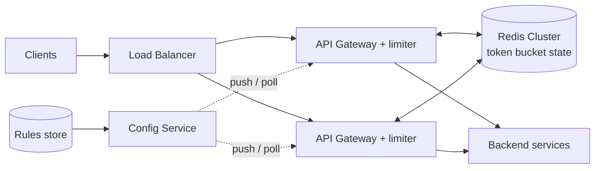

# Design a Distributed Rate Limiter

Limit how many requests a client can make in a time window, consistently across many API servers. The challenge: shared state at very low latency, accuracy vs cost, and not becoming a single point of failure.

## 1. Requirements

**Functional**
1. Identify clients (user ID, API key, IP) and enforce configurable limits (e.g. 100 requests/min per user, plus a per-endpoint limit).
2. Reject excess requests with `429` and inform the client when to retry.

**Out of scope**: billing/quotas over months, DDoS mitigation at network layers (handled by edge/WAF).

**Non-functional**
- Adds under ~5 ms to each request.
- Highly available: the limiter must not take the API down (**fail open** by default).
- Scale: ~1M requests/s across the fleet, ~100M distinct keys.
- Reasonable accuracy: small overshoot tolerated, strict limits for sensitive endpoints.
- Dynamic configuration without redeploys.

## 2. Core Entities

- **Rule** (key type, limit, window/refill rate, scope), **Client/Key**, **Counter/Bucket state**

## 3. API

Internal call from the gateway (or an in-process library):

```
allow(clientKey, ruleId) -> { allowed: bool, remaining: int, resetAt: ts }
```

Client-facing response on rejection:

```
HTTP 429 Too Many Requests
Retry-After: 12
X-RateLimit-Limit: 100
X-RateLimit-Remaining: 0
```

## 4. High-Level Design



Where to place it: at the **API gateway** (central, consistent), with an optional lightweight limiter in services for internal fairness. Gateways cache the rules locally.

## 5. Deep Dives

### 5.1 Algorithm

| Algorithm | Use here? |
|---|---|
| Fixed window | Cheap; boundary burst up to 2x the limit |
| Sliding window log | Exact, memory heavy per key |
| Sliding window counter | Good approximation, 2 counters per key |
| **Token bucket** | Allows controlled bursts, 2 fields per key; **default choice** |

Token bucket state per key: `tokens`, `lastRefillTs`. On each request compute `tokens = min(capacity, tokens + (now - last) * rate)`, then consume 1 if available.

### 5.2 Atomicity in Redis

Read-modify-write from many gateways races. Use a **Lua script** (atomic in Redis) that refills and consumes in one call:

```lua
-- KEYS[1]=bucket, ARGV: capacity, ratePerSec, nowMs
local b = redis.call('HMGET', KEYS[1], 'tokens', 'ts')
local tokens = tonumber(b[1]) or tonumber(ARGV[1])
local ts = tonumber(b[2]) or tonumber(ARGV[3])
tokens = math.min(tonumber(ARGV[1]), tokens + (tonumber(ARGV[3]) - ts) / 1000 * tonumber(ARGV[2]))
local allowed = tokens >= 1
if allowed then tokens = tokens - 1 end
redis.call('HSET', KEYS[1], 'tokens', tokens, 'ts', ARGV[3])
redis.call('PEXPIRE', KEYS[1], 120000)
return allowed and 1 or 0
```

Use Redis server time (or a single time source) to avoid clock skew between gateways. Set a TTL so idle keys disappear.

### 5.3 Scaling Redis

- Shard keys across a Redis Cluster by key hash; each bucket lives on exactly one shard, so no cross-node coordination.
- ~1M RPS is well within a handful of shards (100k+ ops/s each). Hot keys (a single huge tenant) can be split into sub-buckets (`key#0..N`) each with 1/N of the limit.
- Reduce load with **local batching**: each gateway takes a lease of tokens (e.g. 10% of the limit) from Redis and serves locally, syncing periodically. This trades accuracy for fewer Redis calls and lower latency.

### 5.4 Failure behavior

- If Redis is unreachable or slow, **fail open** with a short timeout (~2-5 ms) and fall back to a conservative local in-memory limiter so abuse is still bounded. For critical or paid endpoints, fail closed.
- Replication is asynchronous; after a failover a few counters may reset, which is acceptable.
- Circuit-break the limiter dependency so a slow Redis doesn't add latency to every request.

### 5.5 Multi-region

- Per-region limits are simplest (each region enforces its own share).
- Global exact limits need cross-region coordination, which is slow; use per-region quotas that are periodically rebalanced.

### 5.6 Dynamic configuration

Rules live in a config store, are cached in gateways, and are updated by push (pub/sub) or short polling. Version the rules and roll them out gradually.

## 6. Staff-Level Notes

- **Trade-offs**: accuracy vs latency (central atomic check vs local leases); fail-open protects availability but exposes backends during an outage.
- **Fairness**: layered limits (per IP, per user, per tenant, global) and priority classes so one tenant can't starve others.
- **Client behavior**: return `Retry-After`; well-behaved SDKs back off with jitter.
- **Observability**: allowed vs rejected rate per rule, top limited keys, limiter latency p99, Redis CPU and memory, fail-open count.
- **Evolution**: adaptive limits from backend load (load shedding), cost-based limits (weight per endpoint), quotas with billing.
