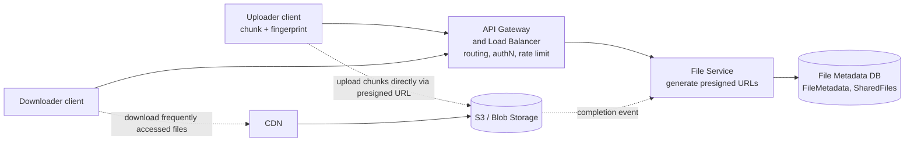

# Design Dropbox (File Storage and Sync)

Store files in the cloud, share them, and keep devices in sync. The challenge: large files, resumable transfers and efficient sync, without proxying bytes through your servers.

## 1. Requirements

**Functional**
1. Users upload and download files from any device.
2. Users share files with other users.
3. Files automatically sync across a user's devices.

**Out of scope**: real-time collaborative editing, full version history UI.

**Non-functional**
- Availability over consistency for metadata reads across devices (eventual sync is fine).
- Files up to ~50 GB; uploads must be resumable.
- Low latency for upload/download; throughput bounded by client bandwidth, not our servers.
- Durable: no file loss (11 nines via object storage).
- Integrity: detect corruption; scale to ~500M users, billions of files.

**Estimation that drives the design**: 50 GB through an API server is unreasonable, so bytes must go directly between client and object storage.

## 2. Core Entities

- **File** (bytes in object storage)
- **FileMetadata**: id, name, size, mimeType, owner, status, storage key
- **User**
- **SharedFile**: user id, file id

## 3. API

```
POST /v1/files                  -> { fileId, uploadUrls[] }   (metadata + presigned URLs)
PATCH /v1/files/{id}            -> mark chunk/upload state
GET  /v1/files/{id}             -> { metadata, downloadUrl }
POST /v1/files/{id}/shares      body: { userId }
GET  /v1/changes?cursor=...     -> changed files since cursor (sync)
```

## 4. High-Level Design



**FileMetadata**: `fileId` (PK), `name`, `size`, `mimeType`, `uploadedBy`, `status` (uploading/uploaded), `s3Key`, `chunks`, `fingerprint`. **SharedFiles**: `(userId, fileId)`, with a GSI by `fileId` and by `userId`.

- **Upload**: client POSTs metadata with status `uploading`. File Service returns presigned URLs. Client uploads straight to S3. A storage event notification marks the file `uploaded`.
- **Download**: File Service checks authorization and returns a presigned (or CDN signed) URL. Hot files are served from the CDN.

## 5. Deep Dives

### 5.1 Large files: chunking and resumable upload

- Client splits the file into ~5-10 MB chunks and computes a **fingerprint** (hash) of the file and each chunk.
- Use **multipart upload**: each chunk gets its own presigned URL, uploaded in parallel and retried independently.
- Progress is recorded (per-chunk status in the metadata DB, or S3's `ListParts`). After a crash the client asks "which chunks are done?" and continues.
- Complete the multipart upload with an ordered list of chunk ETags.

### 5.2 Fast and efficient sync

- Client watches the local folder (OS file events) and, for changes, computes chunk hashes; uploads only **changed chunks** (delta sync).
- Chunk-level **deduplication**: chunks addressed by content hash; identical chunks (even across users, subject to privacy policy) are stored once.
- Remote to local: clients keep a **cursor** and poll or hold a long-poll/WebSocket for a change notification, then call `/changes?cursor=` to fetch metadata deltas and download changed chunks.
- Conflict policy: on concurrent edits keep both (`file (conflicted copy)`), never silently overwrite. Each file has a version number for optimistic concurrency.

### 5.3 Security

- Presigned URLs are short lived (minutes) and scoped to one object and method.
- Encrypt at rest (SSE/KMS) and in transit (TLS). Authorization on every metadata and URL-issuing call.
- Shared files: check `SharedFiles` on each access; revoke by deleting the row (existing URLs expire quickly).

### 5.4 Metadata scale

- Metadata is small, relational-ish: shard by `ownerId` (or `fileId`). DynamoDB/Cosmos DB or sharded PostgreSQL both work.
- The sharing lookup needs both directions ("my shared files" and "who can see this file"), so keep two indexes/tables.

### 5.5 Cleanup

- Abandoned multipart uploads are aborted by a lifecycle rule after N days.
- Deletes are soft first, with a retention window, then garbage collection of unreferenced chunks (reference counting needed because of dedup).

## 6. Staff-Level Notes

- **Trade-offs**: dedup saves storage but adds metadata and privacy concerns (cross-user dedup leaks existence of content); small chunks give better dedup but more metadata.
- **Failure modes**: upload completes but the event is lost, so a reconciliation job lists `uploading` rows older than X and verifies against S3. Eventual consistency of sync means a device can be briefly behind.
- **Observability**: upload success rate, time to sync, resumed-upload ratio, orphaned chunks, CDN hit ratio, event-notification lag.
- **Evolution**: block-level server-side deltas, cold-tier lifecycle, regional storage for residency, virus scanning pipeline on upload.
