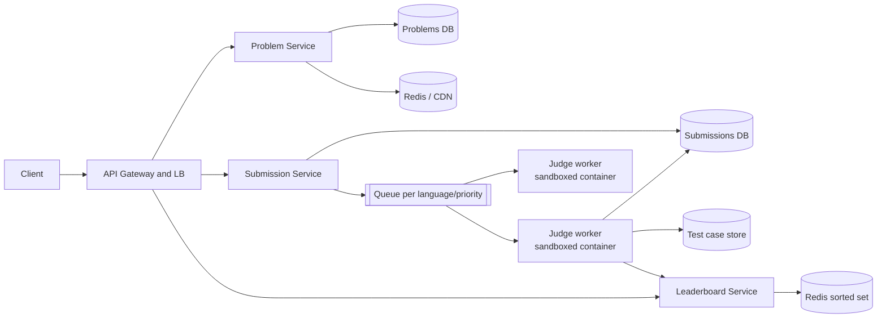

# Design LeetCode (Online Judge)

Browse problems, submit code, get a verdict, see contest leaderboards. The challenge: executing untrusted code safely and fairly at scale, especially during contests.

## 1. Requirements

**Functional**
1. Users view a list of problems and a problem's description.
2. Users submit a solution in a chosen language and get a pass/fail result with details.
3. Users see a live leaderboard during a contest.

**Out of scope**: user-generated problems, discussion forums, payments.

**Non-functional**
- **Security and isolation**: untrusted code must not escape, read other submissions or abuse resources.
- Availability for browsing; consistent, fair results for submissions.
- Verdict within a few seconds for typical submissions.
- Scale: ~100k concurrent contest users, a submission burst at contest start/end.
- Fairness: deterministic limits (CPU time, memory) per run.

## 2. Core Entities

- **Problem** (statement, test cases, limits), **Submission** (code, language, status, result), **User**, **Contest**, **Leaderboard entry**

## 3. API

```
GET  /v1/problems?page=&tag=            -> Problem[] (summary)
GET  /v1/problems/{id}                  -> Problem
POST /v1/problems/{id}/submissions      body: { language, code } -> 202 { submissionId }
GET  /v1/submissions/{id}               -> { status, result }   (poll)
GET  /v1/contests/{id}/leaderboard?page= -> entries
```

## 4. High-Level Design



- **Submit**: store the submission as `queued`, publish a job, return `202` immediately.
- **Judge**: a worker pulls a job, compiles and runs the code in a sandbox against test cases, writes the verdict.
- **Client** polls the submission status (or uses SSE/WebSocket) until it completes.

## 5. Deep Dives

### 5.1 Safe execution of untrusted code

| Layer | Mechanism |
|---|---|
| Isolation | Container with a hardened runtime (gVisor, Firecracker microVM, or nsjail), non-root user, read-only root filesystem |
| Resources | cgroups: CPU time, memory, process count, output size; wall-clock timeout |
| Network | Disabled |
| Syscalls | seccomp allowlist |
| Lifecycle | One fresh sandbox per submission (or pooled and wiped); destroy afterward |

A container alone is not a strong security boundary against kernel exploits; for hostile code prefer microVMs or user-space kernels. Run judge workers in a separate, locked-down network/account from the main services.

### 5.2 Scaling with queues

- Decouple submission intake from execution with a **queue**; workers autoscale on queue depth and oldest-message age.
- Separate queues per language and priority (contest above practice) so a slow language or a flood of practice runs can't starve contests.
- At-least-once processing: worker acks after writing the verdict; judging is **idempotent** per `submissionId` (a duplicate run overwrites the same verdict).
- Pre-warm workers and cache language images; compile caching where possible.
- Pre-scale before a contest start (known schedule) rather than only reacting.

### 5.3 Fairness and correctness

- Run on homogeneous hardware with pinned CPU and measure CPU time, not wall time.
- Run each test against the same limits; compare outputs with a checker (exact, or custom for problems with multiple valid answers).
- Fetch tests from storage by `problemId` (cached on the worker); keep hidden tests secret.
- Optionally rerun borderline TLEs to reduce noise.

### 5.4 Leaderboard

- Contest score updates go to a Redis **sorted set** (`ZADD`, score encodes points and penalty time) giving O(log N) updates and `ZREVRANGE` for pages.
- Persist in the DB as the source of truth; rebuild the Redis state if lost.
- Cache pages for a second or two; thousands of viewers need not each hit Redis for fresh rank.

### 5.5 Browsing

Problem statements change rarely: cache at the CDN and in Redis; the problems DB sees almost no read load.

## 6. Staff-Level Notes

- **Trade-offs**: microVM isolation is safer but slower to start; mitigate with warm pools. Polling is simple; push scales better.
- **Failure modes**: worker crash mid-run means the message becomes visible again and is retried; a poison submission that kills workers goes to a DLQ after N attempts and is marked `internal error`. Fork bombs and output floods hit limits.
- **Abuse**: rate limit submissions per user; detect plagiarism offline.
- **Observability**: queue depth, time-to-verdict p99, sandbox start time, worker utilization, verdict distribution, sandbox escape alerts via audit logs.
- **Evolution**: interactive problems, multi-file projects, regional worker pools.
