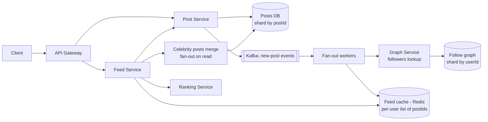
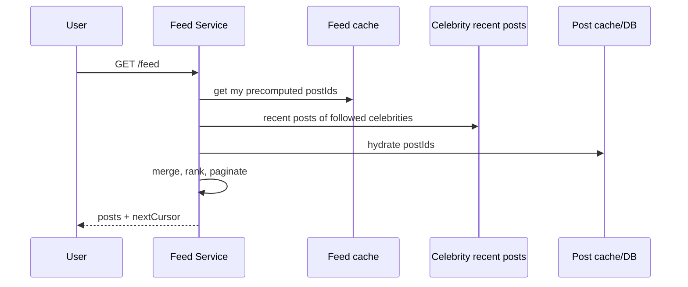

# Design a News Feed (Facebook-style)

Users follow others and see a ranked, fresh feed of their posts. The challenge: delivering a personalized feed with low latency to hundreds of millions of users, including the "celebrity problem" where one post must reach millions.

## 1. Requirements

**Functional**
1. Users create posts (text, media).
2. Users follow/friend other users.
3. Users view a feed of posts from the people they follow, newest/most relevant first, with pagination.

**Out of scope**: likes/comments, ads, ranking model internals, search.

**Non-functional**
- **Availability over consistency**: a post may show up in feeds after a few seconds (eventual consistency, aim under ~1 minute).
- Feed load latency under 200 ms p99.
- Scale: ~2B users, ~500M DAU; users follow up to ~5,000 accounts; heavy skew (celebrities with 100M followers).
- Read:write ratio very high (feed reads far outnumber posts).

**Estimation that drives the design**: 500M DAU opening the feed ~10 times a day is ~5B feed reads/day, about 58k RPS average and several times that at peak. Computing a feed by querying followed users on every read does not scale, so the work must move to write time (precompute) for most users.

## 2. Core Entities

- **User**, **Post**, **Follow** (edge: follower, followee), **Feed entry** (userId, postId, score)

## 3. API

```
POST /v1/posts                body: { text, mediaIds[] } -> { postId }
POST /v1/follows              body: { followeeId }
DELETE /v1/follows/{followeeId}
GET  /v1/feed?cursor=&limit=  -> { posts[], nextCursor }
```

## 4. High-Level Design



- **Publish**: save the post, emit an event. Fan-out workers look up the author's followers and push the `postId` into each follower's feed list in Redis (**fan-out on write**).
- **Read**: Feed Service fetches the user's precomputed list of IDs (cheap), **hydrates** posts (from a post cache/DB), merges in celebrity posts, ranks, and returns a page.

**Tables**: `Post(postId, authorId, content, mediaRefs, createdAt)`; `Follow(followerId, followeeId, createdAt)` indexed both ways (who do I follow, who follows me). Feed cache holds only post IDs, never content.

## 5. Deep Dives

### 5.1 Fan-out on write vs on read

| | Fan-out on write (push) | Fan-out on read (pull) |
|---|---|---|
| Read cost | O(1): read precomputed list | O(followees): query and merge many users |
| Write cost | O(followers) per post | O(1) |
| Freshness | Delayed by fan-out time | Always fresh |
| Problem | Celebrities: 100M followers means 100M writes per post | Slow reads, heavy DB load |

### 5.2 Hybrid (the usual answer)

- **Normal users**: push to followers' feed caches.
- **Celebrities** (followers above a threshold, e.g. 100k-1M): do **not** fan out. At read time, the Feed Service merges the user's precomputed list with recent posts from the celebrities they follow (fetched from a per-author recent-posts cache, which is hot and shared by millions of readers).
- Skip fan-out to **inactive** users (no login for 30 days); rebuild their feed on return.
- Cap feed lists (e.g. last ~800 IDs) so memory is bounded.



### 5.3 Pagination and consistency of the view

Use **cursor** pagination keyed by `(score or timestamp, postId)` so new posts arriving don't shift pages. Keep the cursor stable per session.

### 5.4 Ranking

Start with reverse chronological; later add a ranking service scoring a candidate set (a few hundred posts) with features (affinity, recency, engagement). Ranking happens at read time on the candidate IDs, so cached lists stay generic.

### 5.5 Scaling storage and hot spots

- Posts: shard by `postId` (even spread); cache hot posts; media in object storage + CDN.
- Follow graph: shard by `userId`, with separate follower and followee tables; very large follower lists are paged.
- Feed cache: Redis Cluster sharded by `userId`; replicas for availability; rebuildable from the graph and posts if lost (a cache, not a source of truth).
- Kafka partitioned by authorId (or random) with many fan-out workers; batch writes into Redis pipelines.

### 5.6 Deletes, unfollows and privacy

Unfollow removes the followee's posts lazily at read time (filter by current follow set) instead of rewriting caches. Deleted posts are filtered at hydration (tombstone check).

## 6. Staff-Level Notes

- **Trade-offs**: write amplification vs read latency; threshold for "celebrity" is tunable and can be per-author based on follower count and post rate. Memory cost of feed caches vs recompute cost.
- **Failure modes**: fan-out backlog during a viral event, so shed by prioritizing active users and degrade to pull. Feed cache loss means a cold start for many users at once, so protect the DB with request coalescing and rate limits, and rebuild lazily.
- **Observability**: fan-out lag (post time to first appearance), feed p99, cache hit ratio, hydration miss rate, Kafka consumer lag, write amplification per post.
- **Evolution**: ML ranking and candidate generation beyond the follow graph, interest-based feeds, per-region feed caches, near-real-time updates via SSE.
