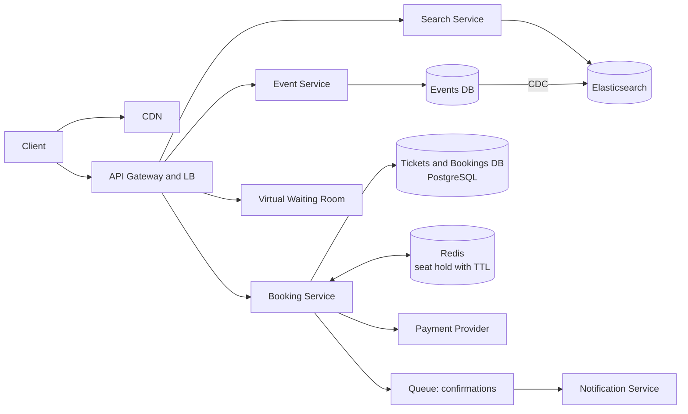
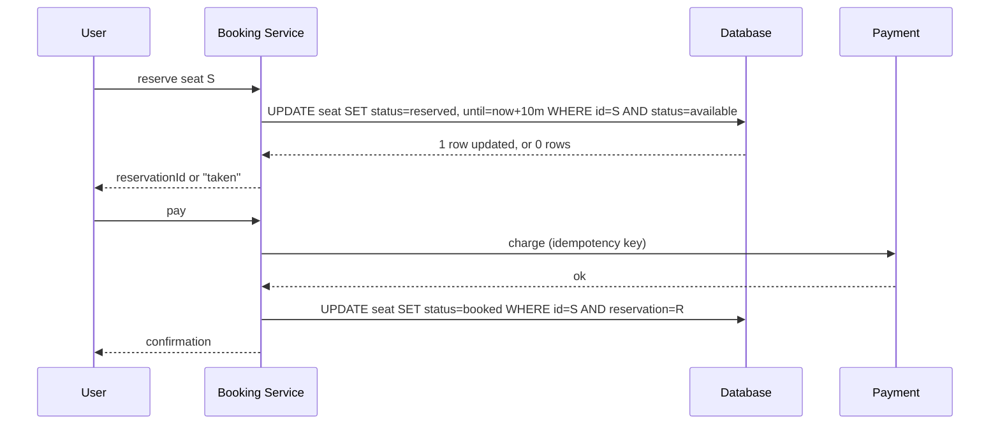

# Design Ticketmaster

Browse events, view available seats and book tickets. The challenge: preventing double booking under heavy contention, and surviving flash-crowd demand when a popular event goes on sale.

## 1. Requirements

**Functional**
1. Users search and view events.
2. Users view seat availability for an event.
3. Users book tickets (reserve, pay, confirm).

**Out of scope**: dynamic pricing, resale marketplace, venue management.

**Non-functional**
- **Strong consistency for booking**: never sell a seat twice.
- High availability for search and browsing (eventual consistency is fine).
- Scales to flash sales: millions of users competing for ~50k seats.
- Search latency under ~500 ms.
- Read-heavy: browsing outnumbers booking about 100:1.

## 2. Core Entities

- **Event**, **Venue**, **Performer**, **Ticket** (seat of an event, with status), **Booking**/**Order**, **User**

## 3. API

```
GET  /v1/events?query=&city=&date=      -> Event[]
GET  /v1/events/{eventId}               -> Event + seat map
POST /v1/events/{eventId}/reservations  body: { seatIds[] }     -> { reservationId, expiresAt }
POST /v1/bookings                       body: { reservationId, paymentToken } -> Booking
```

## 4. High-Level Design



**Tickets**: `ticket_id`, `event_id`, `seat`, `status` (available / reserved / booked), `reserved_until`, `booking_id`.

## 5. Deep Dives

### 5.1 No double booking: reserve then pay

Two-phase flow: **hold** a seat for ~10 minutes while the user pays, then **confirm**.



| Option | How the hold is enforced | Notes |
|---|---|---|
| DB conditional update (**recommended core**) | `WHERE status='available'` is atomic; expiry via `reserved_until` check | Single source of truth, simple, correct |
| Redis lock with TTL | `SET seat NX EX 600` | Fast, auto expiry; still confirm in the DB; Redis loss can release holds |
| Pessimistic `SELECT FOR UPDATE` | Row lock | Fine at low contention, holds connections |
| Distributed lock service | ZooKeeper/etcd | Heavy for this need |

Treat the DB as the authority. Optionally put Redis in front as an **optimization** for hold TTL and to reject hot-seat contention cheaply. An expired hold is reclaimed lazily (`reserved_until < now` counts as available) plus a sweeper job.

### 5.2 Flash crowds: virtual waiting room

When 1M users hit one on-sale:
- **Virtual waiting room**: an edge queue admits users at a rate the booking path can handle, issuing signed admission tokens.
- Static event pages and the seat map (non-authoritative) are cached at the CDN.
- Seat availability shown to users is **eventually consistent** and refreshed by SSE/polling; the actual guarantee comes from the conditional update.
- Rate limit per user/IP and bot defense (CAPTCHA, device attestation).

### 5.3 Fast, scalable search

- Events are low-write, high-read: index in **Elasticsearch** via CDC from the events DB for text/geo/date filters.
- Cache popular queries in Redis/CDN. Search can lag by seconds; that is acceptable.

### 5.4 Payment correctness

- Use an **idempotency key** per booking attempt with the payment provider.
- Handle "charged but confirm failed" with a reconciliation job and a saga: if confirm cannot complete, refund or complete asynchronously.
- Do not hold DB transactions open across the payment call.

## 6. Staff-Level Notes

- **Trade-offs**: a hold TTL that is too long starves inventory; too short frustrates users. Show a countdown.
- **Failure modes**: DB primary failover during a sale. Keep the booking path on one strongly consistent store partitioned by `event_id`, with a synchronous replica; avoid multi-region writes for the same event.
- **Hot partition**: one event is the hot key. Shard seats by section within an event if a single node can't take the write rate.
- **Observability**: seats held vs booked, hold expiry rate, conflict rate, waiting room depth, payment failure rate, p99 booking latency.
- **Evolution**: best-available seat selection, group purchases, dynamic pricing.
