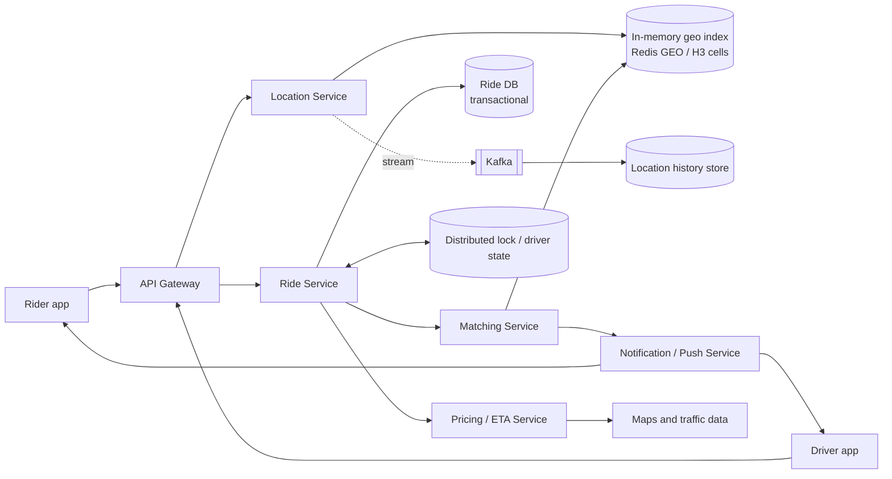

# Design Uber (Ride Matching)

Riders request rides; nearby drivers are matched in real time. The challenge: a continuous stream of driver location updates, fast geospatial lookup, and consistent, race-free driver assignment.

## 1. Requirements

**Functional**
1. Riders enter a pickup and destination and get a fare estimate.
2. Riders request a ride; the system matches a nearby available driver.
3. Drivers accept or decline and navigate to the rider.

**Out of scope**: ride types/pooling, payments, ratings, surge pricing detail.

**Non-functional**
- Low latency matching (under ~1 minute to find a driver; location lookups under ~100 ms).
- **Consistency in assignment**: a driver is never matched to two rides; a ride gets at most one driver.
- High availability and resilience to demand spikes (events, rain, rush hour).
- Scale: ~10M rides/day, ~5M online drivers.

**Estimation that drives the design**: drivers send a location every ~4 s, so 5M drivers is about **1.25M writes/s**. That load is far too high for a transactional DB and calls for an in-memory geospatial index, with durable history written asynchronously.

## 2. Core Entities

- **Rider**, **Driver**, **Ride** (state machine), **Location** (driver position), **Fare estimate**

## 3. API

```
POST /v1/rides/estimate   body: { pickup, destination } -> { fare, eta }
POST /v1/rides            body: { estimateId }          -> { rideId, status: requested }
PUT  /v1/drivers/location body: { lat, lng }            -> 204   (periodic; auth gives driverId)
PATCH /v1/rides/{id}      body: { action: accept|decline|arrive|complete } (driver)
GET  /v1/rides/{id}       -> ride + driver location (push via WebSocket/SSE too)
```

## 4. High-Level Design



**Ride**: `rideId`, `riderId`, `driverId?`, `pickup`, `dropoff`, `status` (requested, matched, accepted, in_progress, completed, cancelled), `fare`, timestamps.

- **Driver updates**: write the latest position into the geo index (overwrite, TTL ~15 s so offline drivers disappear). Stream to Kafka for history and analytics.
- **Request**: Ride Service persists the ride, Matching Service finds candidates near the pickup, and offers the ride to drivers one by one (or a few at a time).

## 5. Deep Dives

### 5.1 Fast nearby search

| Index | Idea | Notes |
|---|---|---|
| Geohash | String prefixes of a lat/lng grid | Easy in Redis/DBs; neighbors across cell boundaries need extra queries |
| Quadtree | Adaptive subdivision where dense | Good for uneven density; in-memory structure to maintain |
| **H3 / S2 cells** | Hexagonal or spherical cells at fixed resolution | Uniform neighbors, works well with sharding |

Use a **grid-cell index**: map each available driver to a cell (e.g. H3 resolution ~7-9). Query the rider's cell plus the surrounding ring and sort by ETA. Shard the index by cell/region so each shard handles a geographic area. Redis `GEOSEARCH` is enough at moderate scale; a custom in-memory service is used at the biggest scale.

### 5.2 Absorbing the location firehose

- Update only the **latest** position in memory; it is overwritten, not appended.
- Throttle on the client: send more often when on a trip, less when idle or stationary; adaptive intervals.
- Durable history goes through Kafka to cheap storage in batches; it's not on the critical path.
- Location data loss is tolerable (the next update arrives within seconds), so no strong durability is needed for the live index.

### 5.3 Consistent matching (no double assignment)

Race: two ride requests pick the same nearest driver. Fix by making assignment an **atomic state transition**:

1. Matching picks a candidate and sets the driver state `available -> offered(rideId)` using a conditional write or `SET driver:{id} rideId NX PX 15000`.
2. If it fails, skip to the next candidate.
3. Driver accepts within the timeout, then driver state becomes `on_trip` and ride becomes `accepted` in the ride DB. On decline or timeout the lock expires and the next candidate is offered.

Offer to drivers **sequentially** by ETA (avoids spamming and races) or in small batches for speed in busy areas. The ride record is authoritative; the lock is for contention control, with the DB state transition guarded by optimistic version checks.

### 5.4 Reliability of the ride lifecycle

- Ride Service is the source of truth, with a state machine and idempotent transitions (retried messages don't double-apply).
- Persist before pushing notifications. If the driver's app loses connection, pushes plus a reconnect-and-sync (`GET /rides/{id}`) recover state.
- Use a durable workflow/queue for matching retries so a Matching Service crash doesn't strand a ride; time-box with a deadline and cancel gracefully.

### 5.5 Demand spikes

- Autoscale stateless services; the geo index is partitioned by region so a hotspot affects one shard (add replicas and sub-cell splitting).
- Queue ride requests with backpressure and tell riders the wait; apply surge pricing as a demand-control signal.

## 6. Staff-Level Notes

- **Trade-offs**: cell resolution (coarse means fewer queries but more candidates to rank; fine means precision but more cells); sequential vs batched offers (fairness vs speed).
- **Failure modes**: geo shard loss, so drivers re-register on the next update (seconds). Ride DB failover during peak: keep it sharded by region/city with sync replicas.
- **Privacy**: don't expose exact driver trails; retention limits on location history.
- **Observability**: match time p50/p99, offer acceptance rate, driver supply per cell, location update lag, ETA error, cancellation rate.
- **Evolution**: batched/global matching optimization (assign a set of riders to drivers together), ride pooling, predictive repositioning of drivers.
