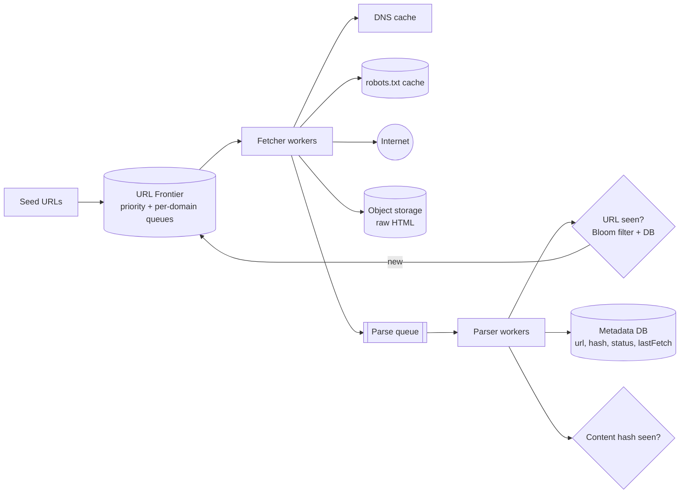

# Design a Web Crawler

Discover and download billions of web pages, extract content and links, and keep it fresh. The challenge: scale, politeness to websites, avoiding duplicate work and recovering from failures without losing progress.

## 1. Requirements

**Functional**
1. Starting from seed URLs, crawl pages and extract text and outbound links.
2. Store the page content for downstream use (e.g. search index or LLM training).
3. Respect `robots.txt` and crawl each site politely.

**Out of scope**: JavaScript-rendered pages (mention headless rendering as an extension), search/indexing, ranking.

**Non-functional**
- **Scale**: ~1B pages crawled in ~5 days (about 2.3k pages/s sustained); average page ~2 MB gives ~2 PB total raw.
- **Fault tolerant**: crashes must not lose the frontier or re-crawl everything.
- **Politeness**: limit request rate per domain; honor `Crawl-delay` and `robots.txt`.
- **Efficiency**: avoid fetching duplicates and traps.
- Eventually fresh: re-crawl pages on a schedule based on change rate.

## 2. Core Entities

- **URL** (state, depth, priority, next fetch time), **Page/Document** (content, hash, fetch metadata), **Domain** (robots rules, rate limit, next allowed time)

## 3. API / Interface

A pipeline, not a user-facing API. Interfaces:

```
Frontier.enqueue(url, priority)
Frontier.next() -> url               (respects per-domain politeness)
Fetcher.fetch(url) -> { status, body, headers }
Store.put(url, contentHash, blobKey, meta)
```

## 4. Data Flow

1. Take a URL from the frontier.
2. Resolve DNS and fetch (after `robots.txt` check).
3. Store raw content (object storage) and metadata.
4. Parse the HTML and extract links.
5. Normalize and filter links, drop already-seen URLs.
6. Enqueue new URLs to the frontier; repeat.

## 5. High-Level Design



**Metadata** per URL: `url` (normalized), `status`, `lastFetched`, `etag/lastModified`, `contentHash`, `nextFetchAt`, `depth`, `failureCount`.

Separate **fetching** (network-bound, many workers) from **parsing** (CPU-bound) with a queue so each scales independently and a slow parse doesn't hold up fetching.

## 6. Deep Dives

### 6.1 Frontier and politeness

- One logical queue per **domain** (or host), mapped to a worker by hash(domain), so each domain is handled by one fetcher at a time. That makes rate limiting trivial: keep `nextAllowedTime` per domain.
- A **priority layer** in front decides which domains get served first (e.g. by site importance and change frequency); a **politeness layer** behind it enforces per-domain delays (the Mercator design).
- Honor `robots.txt` (cached per domain with TTL) and `Crawl-delay`; set a clear User-Agent and back off on 429/5xx.
- Implement as Kafka/SQS topics keyed by domain, or Redis sorted sets keyed by `nextAllowedTime`, with a DB for durability.

### 6.2 Fault tolerance

- The frontier state is durable (queue or DB); fetchers are stateless. A crashed worker's in-flight URL becomes visible again (visibility timeout) and is retried.
- Idempotent writes: store keyed by URL/content hash so a duplicate fetch is harmless.
- Retry with exponential backoff, then mark `failed` after N attempts; DLQ for inspection.
- Checkpoint progress in the metadata DB, never only in memory.

### 6.3 Deduplication

| Level | How |
|---|---|
| URL seen | Normalize (lowercase host, remove fragments, sort params, resolve relative links), then check a **Bloom filter** (fast negative) backed by the metadata DB. 1B URLs at ~1% false positives needs about 1.2 GB |
| Content duplicate | Hash page body (exact) or SimHash/MinHash (near duplicates) to skip storing or following mirrors |

Bloom false positives only mean a few URLs are never crawled; acceptable.

### 6.4 Crawler traps and quality

- Depth and per-domain URL caps; detect infinite calendars/session IDs via URL pattern heuristics.
- Content-type and size limits; timeouts on slow servers.
- Spam and low-quality filters feed the priority score.

### 6.5 Scaling

- Shard the frontier and metadata by domain hash; add fetcher nodes linearly.
- **DNS** is a hidden bottleneck: run a local caching resolver, and batch/prefetch lookups.
- Spread fetchers across regions close to targets; keep per-IP politeness in mind when using many IPs.
- 2.3k pages/s x 2 MB is about 4.6 GB/s (~37 Gbps) of ingress, so network and storage throughput matter. Compress content before storing.

### 6.6 Freshness

Re-crawl by estimated change rate (adaptive interval: shorten if the page changed, lengthen if not). Use conditional GET (`If-None-Match`/`If-Modified-Since`) to save bandwidth.

## 7. Staff-Level Notes

- **Trade-offs**: strict politeness slows coverage; breadth-first favors quality, depth-first finds traps; Bloom filters trade memory for a small miss rate.
- **Failure modes**: a hot domain monopolizing workers (cap concurrency per domain), poisoned pages crashing parsers (sandbox and DLQ), DNS outage (multiple resolvers).
- **Compliance/ethics**: honor robots and opt-outs, identify the crawler, avoid personal data collection issues.
- **Observability**: pages/s, success vs error by status code, frontier size per priority, per-domain lag, duplicate ratio, age of oldest uncrawled high-priority URL.
- **Evolution**: headless browser rendering pool for JS pages, incremental crawling driven by sitemaps and change feeds, distributed crawling across regions.
