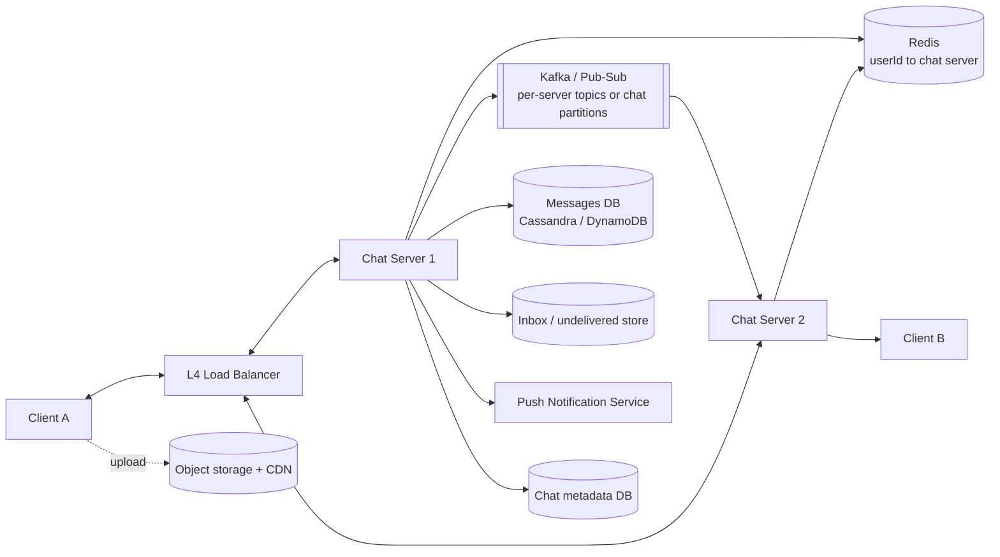

# Design WhatsApp (Chat)

Send messages in real time between users and groups, including when recipients are offline. The challenge: persistent connections at massive scale, delivery guarantees and per-conversation ordering.

## 1. Requirements

**Functional**
1. Users start group chats (up to ~100 participants) and 1:1 chats.
2. Users send and receive messages in real time.
3. Users receive messages sent while they were offline (store and deliver for a limited time).
4. Users send media (images, video).

**Out of scope**: voice/video calls, end-to-end encryption details, status/stories.

**Non-functional**
- Low latency delivery (under 500 ms for online users).
- **Delivery guarantee**: at-least-once with client dedup, effectively exactly-once to the user; no message loss.
- Ordered within a chat.
- Scale: ~1B users, ~100B messages/day (~1M msgs/s), millions of concurrent connections.
- Availability over consistency for presence; consistent order within a chat.

**Estimation that drives the design**: one host holds roughly 100k-1M idle WebSocket connections, so ~10M-50M concurrent users means thousands of chat servers. We need a way to find which server holds a user's connection.

## 2. Core Entities

- **User**, **Client** (device), **Chat**, **Participant**, **Message**

## 3. API (over WebSocket)

```
-> createChat   { participants[], name? }              <- { chatId }
-> sendMessage  { chatId, clientMsgId, text, mediaId? } <- ack { messageId, ts }
<- newMessage   { chatId, messageId, senderId, text, ts }
-> ack          { messageId }                            (delivery receipt)
POST /v1/media  -> { mediaId, uploadUrl }               (presigned; REST)
```

## 4. High-Level Design



**Chat/Participants**: `chatId`, `participantId`, shared metadata. **Messages**: partition `(chatId, bucket)`, clustering `messageId` (time-sortable).

- **Connect**: client opens a WebSocket to a chat server; the server writes `userId -> serverId` to Redis with a TTL refreshed by heartbeats.
- **Send**: server persists the message, acks the sender, looks up each participant's server and routes via the broker. The recipient's server pushes over the socket. The recipient acks; the sender sees delivered/read receipts.

## 5. Deep Dives

### 5.1 Routing across many chat servers

| Approach | Notes |
|---|---|
| Lookup (userId to server in Redis) + direct server-to-server or broker hop | Standard; Redis loss means users reconnect and re-register |
| Per-server topic in a pub/sub broker | Server subscribes to its own channel; simple fan-out |
| Consistent hashing of userId to server | Needs a connection layer that respects it; resharding is hard with long-lived connections |

Use the lookup approach with a pub/sub or a routing hop. For groups, resolve all member servers and fan out one message per **server** (not per user) when several members share a server.

### 5.2 Reliable delivery and offline users

- On send, **persist first**, then ack the sender. If the recipient is offline (no entry in the routing table), the message stays in an **inbox** for that user and a push notification is triggered.
- On reconnect the client sends its last seen cursor (`lastMessageId` per chat); the server streams everything newer.
- Deliver **at-least-once**; the client dedups by `messageId`. The client generates `clientMsgId` so a retried send doesn't create a duplicate.
- Retain undelivered messages for a TTL (e.g. 30 days).

### 5.3 Ordering

- Order only matters **within a chat**. Assign `messageId` from a per-chat monotonic sequence (single-writer per chat via partitioning by `chatId`) or a time-sortable ID (Snowflake/ULID) with server-side timestamp.
- Partition the broker and the message store by `chatId` so one chat is always handled by one partition.

### 5.4 Storage

- Message store: write-heavy, append-only, read by recent range. Wide-column (Cassandra, DynamoDB) with `chatId` + time bucket as the partition key and clustering by message ID.
- Chat and user metadata in a smaller relational/KV store with cache.
- Once delivered, many systems delete from server storage (device is the store); decide on retention explicitly.

### 5.5 Media

Client uploads to object storage via presigned URL, then sends a message containing the `mediaId`. Recipients download via CDN-signed URLs. Thumbnails are generated asynchronously.

### 5.6 Presence and typing

Heartbeat-based with TTL keys in Redis; do not persist. Throttle updates, and only publish presence to contacts who are viewing the chat to avoid fan-out storms.

## 6. Staff-Level Notes

- **Trade-offs**: persist-then-ack costs latency but prevents loss; per-chat ordering is cheap, global ordering is not needed.
- **Failure modes**: a chat server dies and ~500k clients reconnect at once. Use jittered exponential backoff, connection rate limiting and capacity headroom to avoid a reconnect storm. Redis routing loss self-heals as clients re-register.
- **Hot groups/channels**: fan-out cost scales with members; cap group size or use a different model for broadcast channels.
- **Observability**: connected sockets, send-to-deliver latency p99, ack lag, undelivered backlog, reconnect rate, push success rate.
- **Evolution**: multi-device sync (per-device cursors), E2E encryption with key distribution, message edit/delete, search on device.
