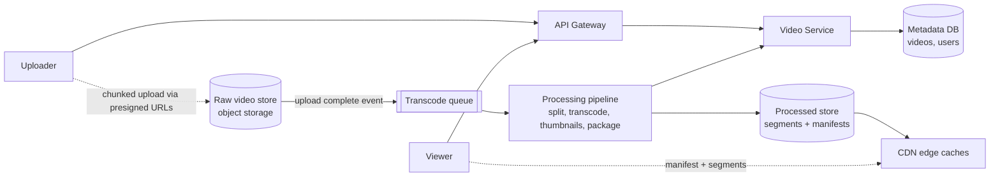
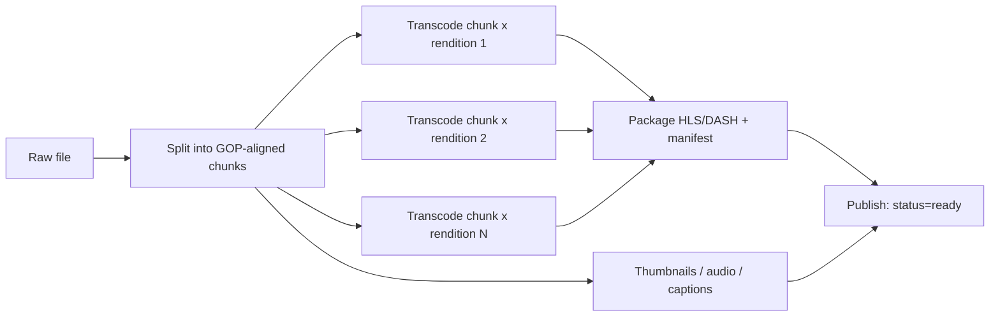

# Design YouTube (Video Upload and Streaming)

Upload videos and watch them smoothly on any device. The challenge: very large files, an asynchronous transcoding pipeline, and delivering video globally at low cost with adaptive quality.

## 1. Requirements

**Functional**
1. Users upload videos.
2. Users watch (stream) videos.

**Out of scope**: search, recommendations, comments, live streaming, monetization.

**Non-functional**
- Availability over consistency: a new video may take minutes to become watchable.
- Smooth playback with low startup time and adaptive quality for varying networks and devices.
- Scale: ~1B DAU, hundreds of thousands of hours uploaded per day, videos up to tens of GB.
- Reliable uploads for big files (resumable); no video loss.

**Estimation that drives the design**: a few hundred MB per upload and billions of views/day means the **read path is a CDN problem** and the write path is a **compute pipeline problem**; neither can run through app servers.

## 2. Core Entities

- **User**, **Video** (metadata), **VideoSegment/Rendition**, **Manifest**

## 3. API

```
POST /v1/videos                 body: { title, description, size } -> { videoId, uploadUrls[] }
PATCH /v1/videos/{id}           (complete upload)
GET  /v1/videos/{id}            -> metadata + manifest URL
GET  <manifestUrl>              (served by CDN) -> adaptive manifest (HLS .m3u8 / DASH .mpd)
GET  <segmentUrl>               (served by CDN) -> video segment
```

## 4. High-Level Design



**Video**: `videoId`, `uploaderId`, `title`, `status` (uploading, processing, ready, failed), `rawKey`, `manifestUrl`, `duration`.

- **Upload**: client gets presigned multipart URLs, uploads chunks directly to object storage. Completion triggers processing.
- **Process**: pipeline produces multiple renditions (240p to 4K) and codecs, cut into short **segments** (2-10 s), plus manifests.
- **Watch**: client fetches the manifest and then segments from the CDN, picking the bitrate based on measured throughput (**adaptive bitrate streaming**).

## 5. Deep Dives

### 5.1 Resumable large uploads

Same technique as file storage: chunked multipart upload with per-chunk presigned URLs and resume via recorded parts. Never proxy bytes through the API tier.

### 5.2 Transcoding pipeline as a DAG



- Split into chunks so many workers transcode in **parallel**; wall-clock time drops from hours to minutes.
- Orchestrate with a workflow engine (Step Functions, Temporal, Airflow) with retries per task and idempotent outputs (deterministic output keys).
- Autoscale workers (CPU/GPU, spot instances) from queue depth. Prioritize short videos and popular creators.
- Make "ready" an explicit state; publish the lowest rendition first so playback can start sooner.

### 5.3 Streaming and CDN

- Store as short segments so a viewer can switch quality at segment boundaries; manifest lists renditions and segment URLs.
- **CDN** serves nearly all bytes. Popular videos stay hot at the edge; a long tail of cold videos pulls from origin (use an origin shield/mid-tier cache to protect object storage).
- Cache keys are immutable (versioned segment URLs), so TTLs can be long.
- Cost control: encode popular videos at more renditions/better codecs (AV1) while the long tail gets fewer. Tier cold originals to cheaper storage.

### 5.4 Metadata and counters

- Metadata DB is read-heavy: shard by `videoId`, cache with Redis. Reads of the watch page hit the cache.
- View counts are high-volume writes: buffer in Kafka/Redis and aggregate asynchronously; show approximate, eventually consistent numbers.

### 5.5 Protection

- Signed, expiring CDN URLs for private/unlisted videos.
- Content moderation/copyright fingerprinting as an async step before `ready`.
- Idempotent processing: a duplicate completion event must not trigger a second pipeline.

## 6. Staff-Level Notes

- **Trade-offs**: more renditions improve experience but multiply storage and compute; chunk-level parallelism adds merge complexity; shorter segments reduce latency but raise request volume.
- **Failure modes**: a transcode worker dies, so the task is retried (idempotent); poison videos go to a DLQ and status `failed`. A CDN regional issue is mitigated by multi-CDN and DNS failover.
- **Observability**: time-to-ready p50/p99, pipeline failure rate by stage, rebuffer ratio, startup time, CDN hit ratio and egress cost.
- **Evolution**: live streaming (ingest, low-latency HLS), per-title encoding optimization, P2P/edge compute to cut egress.
