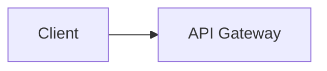
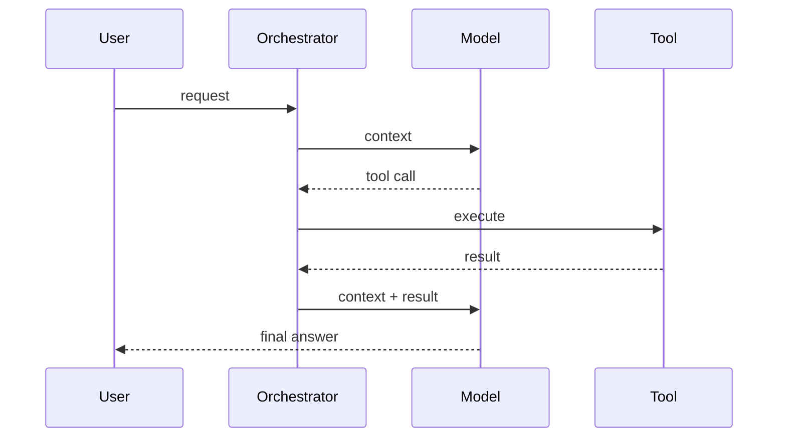

# Design: Agentic Problem Name

One-sentence description and the core challenge (quality, cost, safety or reliability of the agent loop).

## 1. Requirements

**Functional**
1. ...

**Non-functional**
- ... (quantified: TTFT, end-to-end latency, cost per task, task success rate, concurrency)

**Out of scope**
- ...

## 2. Core Entities

- ... (include Run, Tool, Memory or Document where relevant)

## 3. API

```text
METHOD /v1/resource
```

## 4. Data Flow (optional)

1. ... (context assembly, model call, tool call, observation, stop condition)

## 5. High-Level Design



Relevant schema fields and what each request changes.

### Agent loop (optional second diagram)



## 6. Deep Dives

### 6.1 NFR or bottleneck
Problem, options, trade-off, choice, failure mode.

## 7. Staff-Level Notes

- **Trade-offs**
- **Failure modes**
- **Observability**
- **Evolution at 10x**

### Agentic Concerns

| Concern | Answer for this design |
|---|---|
| Quality and evals | Golden set, online signals, regression gate |
| Guardrails and security | Injection, permissions, approvals, PII |
| Cost per task | Token budget, caching, model routing |
| Latency | TTFT, parallel tool calls, streaming |
| Fallback | Cheaper model, cached answer, human handoff |
