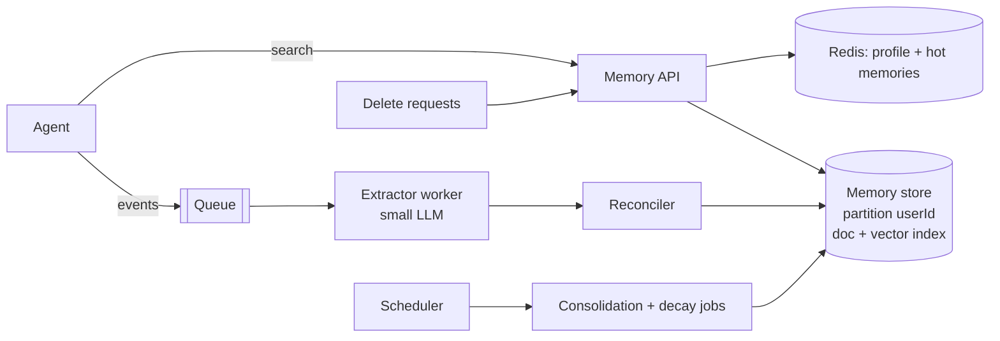

# Design an Agent Memory Service

A shared service that lets many agents remember facts, preferences and past outcomes per user across sessions. The challenge: **what to store, retrieving the right memory in milliseconds, forgetting, and privacy isolation**.

## 1. Requirements

**Functional**
1. Agents write memories from conversations (facts, preferences, episodes).
2. Agents retrieve relevant memories for a user and a query.
3. Memories can be updated, merged, expired and deleted; users can view and delete their memories.

**Out of scope**: document knowledge bases (see [RAG](rag-qa.md)), thread history storage, model training.

**Non-functional**
- Read p95 under 100 ms (it sits on the critical path before the model call).
- Writes are async; visible within 30 s.
- Scale: 50M users, avg 200 memories each = 10B memories (~1 KB each = 10 TB text; vectors dominate). Hot set is the active-user subset, so partition by user.
- Isolation: a user's memories are never returned to another user or tenant.
- Deletion honored across store, index, caches and backups within the compliance window.

## 2. Core Entities

- **Memory** (id, userId, tenantId, scope, type: semantic/episodic/procedural, text, embedding, confidence, source, createdAt, lastUsedAt, ttl, version)
- **Profile** (small pinned facts per user), **ExtractionJob**

## 3. API

```text
POST   /v1/memories/search     body: { query, k, scope?, types? }  -> [Memory]   (user from token)
POST   /v1/memories/events     body: { conversationId, messages[] }   (async extraction)
GET    /v1/memories?cursor=    (user-visible list)
PATCH  /v1/memories/{id}       DELETE /v1/memories/{id}      DELETE /v1/memories   (forget me)
```

## 4. Data Flow

1. After a turn, the agent posts the new messages to `/events` (fire and forget).
2. A worker extracts candidate memories with a small model and a schema.
3. A reconciler compares candidates to existing memories (similar match): add, update, merge or ignore.
4. Store the memory and its embedding; update the profile cache.
5. On the next turn, search returns top-k by similarity, recency and importance.

## 5. High-Level Design



Storage: a document store with a vector index partitioned by `userId`, so a similarity search scans only one user's data (see [Vector Databases](../03-key-technologies/01-databases/vector-databases.md)).

## 6. Deep Dives

### 6.1 What to remember
Extract only durable, useful facts ("prefers metric units", "works on project X") and outcomes, not chit-chat. Use a strict schema and a confidence score; require explicit user statements for sensitive categories. Store **facts, never instructions**, to blunt memory poisoning.

### 6.2 Reconciliation
For each candidate, vector-search the user's existing memories. If very similar: update (newer wins unless pinned) or merge; if contradictory: mark old as superseded with a timestamp; else add. Use versioned upserts keyed by `(userId, normalizedKey)` so concurrent runs do not conflict.

### 6.3 Retrieval
Score = similarity x recency decay x importance, filtered by `userId`, scope and type. Cap k to ~5-10 and apply a similarity threshold so irrelevant memories are not injected. Cache the user profile per session. Return compact text with ids so the agent can cite or correct memories.

### 6.4 Forgetting and consolidation
TTL for episodic memory, decay unused memories, periodically summarize clusters of episodes into semantic facts. **Delete by user** removes rows, vectors and cache keys, and writes a tombstone so replayed events cannot recreate them.

### 6.5 Privacy and security
Mandatory `userId`/`tenantId` filter enforced in the data layer, not by the caller's prompt. Encrypt at rest, classify and redact PII/secrets before storing, expose memory to users for review. Separate scopes: user, tenant-shared, agent-private.

## 7. Staff-Level Notes

- **Trade-offs**: aggressive extraction improves personalization but raises error and privacy risk; reading more memories raises cost and distraction.
- **Failure modes**: bad extraction pollutes memory (feedback and edit tools), duplicates, runaway growth, stale facts, poisoning via crafted conversations.
- **Observability**: extraction acceptance rate, duplicate rate, retrieval hit rate (memory actually used), read latency, memories per user, deletion SLA.
- **Evolution at 10x**: tiered storage for cold users, per-tenant keys, shared team memory with ACLs.

### Agentic Concerns

| Concern | Answer for this design |
|---|---|
| Quality and evals | Test sets of conversations with expected extracted facts; measure precision, recall and contradiction handling; A/B personalized vs not |
| Guardrails and security | Strict user filter, facts not instructions, PII redaction, user-visible and deletable memories |
| Cost per task | Small model for extraction in batches, async off the hot path, cap memories injected |
| Latency | Redis profile cache, single-partition vector search, k capped |
| Fallback | If the service is slow or down, agent proceeds without memory (timeout 100 ms) |
