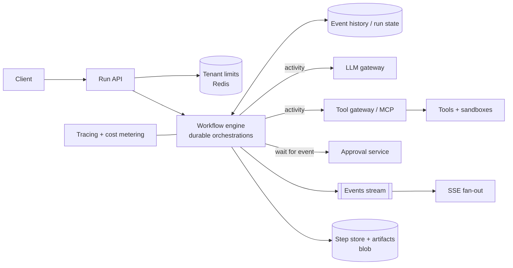

# Design an Agent Runtime (Durable Task Agent Platform)

A platform that runs thousands of concurrent, long-lived agent runs (minutes to days) with tools, retries, human approvals and cancellation. The challenge: **durable state, safe loops, idempotent side effects and fair resource sharing**.

## 1. Requirements

**Functional**
1. Start a run with an agent definition and input; get a `runId`.
2. Runs execute the agent loop (model call, tool call, observe) and stream or poll progress.
3. Pause for human approval and resume; cancel at any time.
4. Retrieve the final result, steps and cost.

**Out of scope**: authoring agents, model hosting, UI.

**Non-functional**
- 100k concurrent runs, 2k run starts/s peak, average run 20 steps over 2 minutes; some run for days.
- A worker crash must not lose progress or repeat side effects.
- Start-to-first-step under 2 s. Per-run budgets: max steps, tokens, cost, wall time.
- Fairness: one tenant cannot starve others.
- Auditability of every step.

## 2. Core Entities

- **AgentDefinition** (prompt, model, tools, policies, budgets), **Run** (status, input, output, budgets used), **Step** (type: model/tool/approval, input hash, output ref, tokens, cost, status), **Approval**, **Tool**

## 3. API

```text
POST /v1/runs                  body: { agentId, input, budgets? }  Idempotency-Key header -> { runId }
GET  /v1/runs/{id}             -> status, result, cost
GET  /v1/runs/{id}/events      (SSE: step events)
POST /v1/runs/{id}/cancel
POST /v1/runs/{id}/approvals/{aid}   body: { decision, comment }
```

## 4. Data Flow

1. API validates, applies tenant limits, creates the Run (idempotent on the key) and starts a durable workflow.
2. Workflow loop: assemble context, call model (activity), validate the tool call, check policy and approval need, execute tool (activity with idempotency key), record the step.
3. Stop on final answer, budget exhaustion, cancel or error; persist the result and emit events.

## 5. High-Level Design



Run state lives in the workflow history (event-sourced) plus a queryable `Run` projection for listing and billing.

## 6. Deep Dives

### 6.1 Durable execution
Use a durable workflow engine (see [Durable Orchestration](../03-key-technologies/durable-orchestration.md)). Orchestration code is deterministic and replayed from history; model and tool calls are **activities whose results are recorded**, so replay never re-calls the model. A crashed worker's runs are picked up by another from the last recorded step. Large payloads (documents, artifacts) go to blob storage with references in history to keep it small; long loops use continue-as-new.

### 6.2 Idempotent side effects
Each tool call has a deterministic idempotency key `runId:stepId:attempt-independent`. Tools must dedupe on it; non-idempotent tools use an **outbox** or two-phase approach (prepare, then commit after approval). Failures after a side effect trigger a **compensation** step (saga) instead of blind retry.

### 6.3 Loop safety and budgets
Hard limits per run: max steps, tokens, dollars, wall time, repeated-call detection and tool-level timeouts. On exhaustion, return a partial result with status `budget_exceeded` or escalate to a human. Validate tool arguments against schemas before executing; unknown tools are rejected.

### 6.4 Human approval and waiting
Approval is a durable external event with a timeout and a default (deny). The run holds no thread while waiting. The approval request records the proposed action, diff and the approver identity; resumed runs re-check the policy since conditions may have changed.

### 6.5 Fairness and scaling
Workers pull from partitioned task queues; per-tenant concurrency limits and weighted fair scheduling prevent starvation. LLM gateway handles TPM quotas, backoff and fallback (see [LLM Fundamentals](../02-core-concepts/14-llm-fundamentals.md)). Autoscale workers on queue depth and oldest-task age. Isolate noisy tenants onto dedicated pools.

### 6.6 Event streaming
Step events are published to a stream; SSE gateways fan out to clients with a replay cursor, so reconnecting clients catch up from the persisted step log instead of the live stream.

## 7. Staff-Level Notes

- **Trade-offs**: workflow engine adds a dependency and determinism constraints but removes bespoke retry and recovery code; recording every step costs storage but enables replay, audit and debugging.
- **Failure modes**: poison run (loops forever: budgets and kill switch), tool outage (circuit breaker, pause run), history growth, worker crash mid-activity (activity timeouts and heartbeats), version change while runs are in flight (versioned workflows, drain old).
- **Observability**: runs by status, step latency by type, tokens and cost per run, approval wait time, queue depth, failure rate by tool, replay errors.
- **Evolution at 10x**: multi-region cells, per-tenant isolation, run priority classes, snapshot caching of context.

### Agentic Concerns

| Concern | Answer for this design |
|---|---|
| Quality and evals | Replay stored runs against new prompt or model versions offline; task success rate per agent version; regression gate |
| Guardrails and security | Policy check before every tool call, approvals for risky actions, tools called with delegated identity, sandboxed code |
| Cost per task | Budgets enforced in the loop, per-tenant spend caps, cheaper model for planning vs execution |
| Latency | Parallel independent tool calls, streaming events, warm workers |
| Fallback | Model fallback, tool fallbacks, partial result, human handoff |
