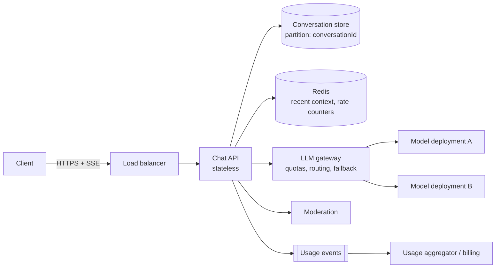

# Design a Chatbot (ChatGPT-style)

A multi-tenant conversational assistant that streams model answers. The challenge: **token streaming at scale, durable conversation history, per-tenant quotas and safety**, all on top of a slow, rate-limited model dependency.

## 1. Requirements

**Functional**
1. Users chat with an assistant and see the answer streamed token by token.
2. Conversations persist: list, reopen, continue, rename, delete.
3. Users can stop generation and regenerate a reply.

**Out of scope**: tool use and RAG (see [RAG Q&A](rag-qa.md)), voice, image generation, billing.

**Non-functional**
- TTFT p95 under 1.5 s; streaming at model speed (~30-80 tokens/s).
- Scale: 10M DAU, ~10 turns per user per day, peak 5x average: ~1.2k turns/s average, ~6k at peak. A turn is ~3k input and ~500 output tokens, so peak is ~18M input TPM. This exceeds one model deployment, so we need several behind a gateway.
- Availability over consistency for history reads; no lost messages after the user saw them.
- Safety: input and output moderation, PII handling, per-tenant budgets.
- Cost per conversation tracked and capped.

## 2. Core Entities

- **User**, **Tenant**, **Conversation**, **Message** (role, content, tokens, model, status), **Usage** (tokens per tenant per window)

## 3. API

```text
POST   /v1/conversations                          -> { conversationId }
GET    /v1/conversations?cursor=                  -> list
POST   /v1/conversations/{id}/messages            (SSE stream)  body: { clientMsgId, text }
POST   /v1/conversations/{id}/messages/{mid}/stop
POST   /v1/conversations/{id}/messages/{mid}/regenerate
DELETE /v1/conversations/{id}
```

User and tenant come from the auth token. `clientMsgId` makes retries idempotent.

## 4. Data Flow

1. Client posts a message; the API stores the user message (idempotent on `clientMsgId`).
2. Context assembly: system prompt, last N turns (or summary), then token budget check.
3. Input moderation and per-tenant token budget check at the gateway.
4. Model call streams tokens; each chunk goes to the client over SSE and is buffered server-side.
5. On completion (or stop), persist the assistant message with token counts; emit usage event.

## 5. High-Level Design



- **Conversation store**: partition key `conversationId` (or `userId` for list queries via a secondary view); messages ordered by time-sortable ID. A document or wide-column store fits (see [Cosmos DB](../03-key-technologies/01-databases/cosmos-db.md), [Cassandra](../03-key-technologies/01-databases/cassandra.md)).
- API servers are stateless, so any replica can serve any turn.

## 6. Deep Dives

### 6.1 Streaming at scale
SSE holds one connection per active generation. At peak ~6k turns/s with ~15 s streams there are ~90k concurrent streams, which is fine across tens of API nodes. Disable proxy buffering, send keep-alives, and cap stream duration. **Client disconnect cancels the upstream generation** to stop paying for tokens. If the client reconnects mid-stream, serve the persisted partial text plus resume from a `lastEventId` cursor stored with the buffered chunks.

### 6.2 Context and history
Options: send full history (simple, costs grow quadratically over a long chat), sliding window, rolling summary. Choose sliding window plus summary of older turns, stored with the conversation, with a hard token budget. Keep a stable prefix (system prompt first) to benefit from provider prompt caching. See [Agent Memory](../02-core-concepts/04-agentic/agent-memory-and-context-engineering.md).

### 6.3 Quotas, routing and fallback
Shared model quota (TPM) is the scarcest resource. Gateway enforces per-tenant token budgets, load balances across deployments, and falls back to a smaller model on 429 or timeout with a visible "reduced quality" flag. Pre-estimate prompt tokens to reject oversize requests early. See [LLM Fundamentals](../02-core-concepts/04-agentic/llm-fundamentals.md) and [Rate Limiter](../04-problem-breakdowns/distributed-rate-limiter.md).

### 6.4 Durability and idempotency
Persist the user message before calling the model. Persist the assistant message once at the end (and periodically for long answers). A retry with the same `clientMsgId` returns the existing message or resumes, never double-charges.

### 6.5 Delivery to other devices
Cross-device sync reuses the connection and ordering ideas from [WhatsApp](../04-problem-breakdowns/whatsapp.md); here a conversation has one active generation at a time (lock per conversation).

## 7. Staff-Level Notes

- **Trade-offs**: summary memory is cheaper but can drift; persisting only at the end risks losing a partial answer on a crash, so checkpoint every few seconds.
- **Failure modes**: provider outage (multi-deployment fallback), SSE through corporate proxies (fallback to long polling), runaway output (max output tokens), abusive tenant (budget).
- **Observability**: TTFT, tokens/s, 429 rate, tokens per tenant, cost per conversation, abort rate, moderation block rate.
- **Evolution at 10x**: regional deployments close to users, semantic cache for FAQ-like traffic (tenant-scoped), prompt caching, then add tools and retrieval.

### Agentic Concerns

| Concern | Answer for this design |
|---|---|
| Quality and evals | Golden prompt set, pairwise comparisons on model or prompt changes, thumbs up/down and regeneration rate online |
| Guardrails and security | Input and output moderation, system prompt treated as public, PII redaction in logs, no tools so low blast radius |
| Cost per task | Token budget per turn and per tenant, summary of old turns, prompt caching, smaller model for easy turns |
| Latency | Streaming, TTFT SLO, regional deployments, trimmed context |
| Fallback | Secondary deployment, smaller model, friendly retry message |
